<p align="center">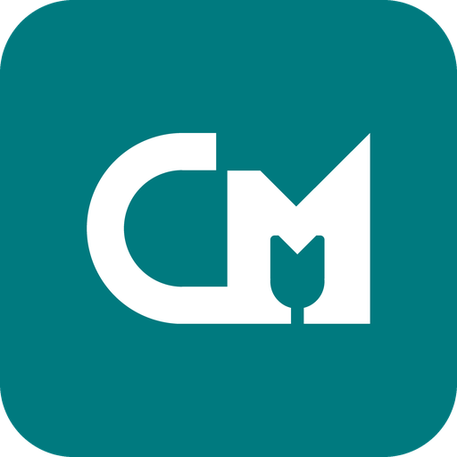</p>

# CordMic

[English](README.md) | **Bahasa Indonesia**

CordMic menjadikan HP Android sebagai mikrofon PC berlatensi rendah lewat **kabel USB**. CordMic memakai fitur bawaan
Android **USB tethering**, jadi tidak perlu Wi-Fi, USB debugging/ADB, atau driver di HP. HP merekam dan merapikan
suara, mengirimnya ke aplikasi tray Windows, lalu aplikasi tray memutarnya ke kabel audio virtual yang bisa dipilih
Discord, Zoom, OBS, dan game sebagai mikrofon.

Versi saat ini: **0.6.0** ([changelog](CHANGELOG.md), [unduhan](https://github.com/Lukecinate/cordmic/releases/latest)).

- **Hanya kabel.** HP muncul sebagai adapter jaringan kabel (RNDIS/NCM). Audio tidak lewat Wi-Fi atau internet.
- **Latensi rendah.** PCM 48 kHz mono dalam paket 5 ms, capture AAudio eksklusif bila diizinkan HP, jitter buffer
  yang disesuaikan dengan periode render Windows yang sebenarnya, kontrol drift dengan resampler, penyamaran packet
  loss berbasis pitch, dan renderer WASAPI milik CordMic sendiri (IAudioClient3 mode shared atau exclusive). Target rancangan sekitar **30–45 ms end-to-end**
  (lihat [Latensi](#latensi)).
- **Pemrosesan suara di HP.** EQ voice clarity, noise cancellation (Mati / Ringan / Kuat), Volume otomatis menuju
  −18 dBFS dengan gate yang mengikuti lantai noise terukur, expander jeda, dan limiter puncak −1 dBFS.
- **Peredam bising Studio di PC (opsional)** (0.6.0, mati secara default). RNNoise di PC dengan perlindungan bisikan
  dan Volume otomatis berbasis loudness; HP lalu mengirim suara tanpa olahan. Menambah sekitar 30 ms.
- **Deteksi otomatis per HP.** HP memeriksa kemampuannya sendiri (engine capture, mikrofon, efek bawaan, API arah,
  level) lalu memilih jalur capture dan pengaturan awal. Yang keluar dari HP hanya ringkasan singkat ke PC lewat
  kabel. Tanpa telemetri.
- **Fokus depan aktif secara default.** Memilih mikrofon yang menghadap pengguna bila Android mengizinkan.
- **Pengaturan dua arah secara langsung.** Pengaturan suara bisa diubah dari HP atau PC saat streaming; perubahan
  terakhir yang berlaku di kedua sisi.
- **Pembaruan dari dalam aplikasi** di kedua sisi, diverifikasi dengan `SHA256SUMS` rilis, tidak pernah downgrade.
- **Jalan di background.** Foreground service Android dengan notifikasi permanen; aplikasi tray Windows yang
  mendeteksi HP, menyambung ulang otomatis, dan bisa ikut jalan saat Windows mulai.
- **Bahasa Inggris dan Indonesia** di aplikasi Android, aplikasi Windows, dan installer.

---

## Isi
- [Tangkapan layar](#tangkapan-layar)
- [Kebutuhan](#kebutuhan)
- [Pasang & mulai cepat](#pasang--mulai-cepat)
- [Aplikasi Windows](#aplikasi-windows)
- [Aplikasi Android](#aplikasi-android)
- [Pemrosesan suara](#pemrosesan-suara)
- [Pembaruan](#pembaruan)
- [Troubleshooting](#troubleshooting)
- [Keterbatasan yang diketahui](#keterbatasan-yang-diketahui)
- [Privasi dan keamanan](#privasi-dan-keamanan)
- [Arsitektur & protokol](#arsitektur--protokol)
- [Latensi](#latensi)
- [Build dari source](#build-dari-source)
- [Receiver Python (alat developer)](#receiver-python-alat-developer)
- [Riwayat versi](#riwayat-versi)
- [Upgrade dari UsbMic](#upgrade-dari-usbmic)
- [Roadmap](#roadmap)
- [Lisensi](#lisensi)

## Tangkapan layar

**Aplikasi Android.** Render asli dari layout aplikasi, dibuat oleh test screenshot Robolectric
(`./gradlew testDebugUnitTest -PrecordScreenshots`) dengan nilai contoh; bukan foto dari HP fisik.

| Menunggu USB tethering | Mencari PC | Streaming ke PC |
|---|---|---|
| 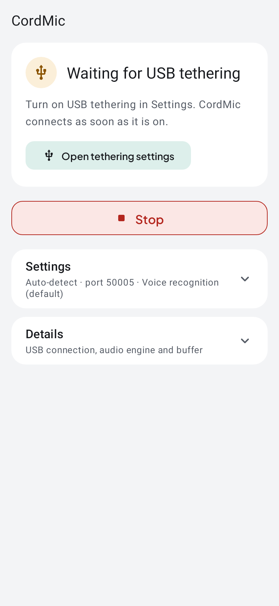 | 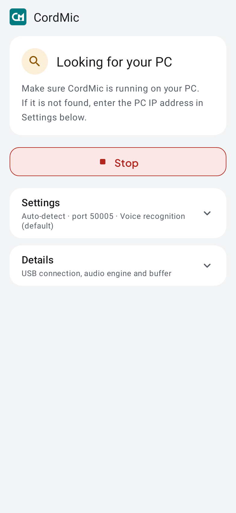 | 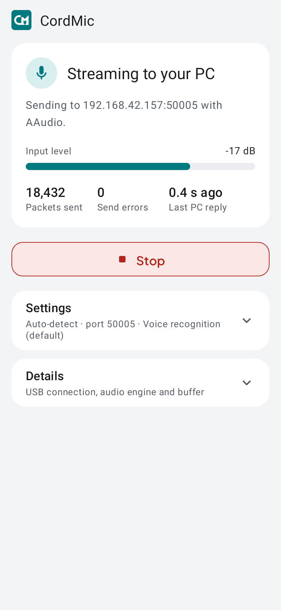 |

| Detail dibuka | Pengaturan (diam) | Mikrofon tidak tersedia |
|---|---|---|
| 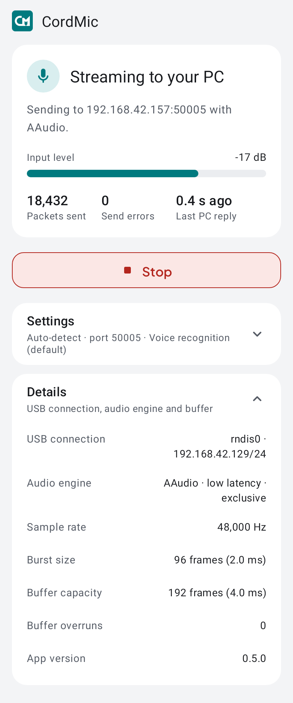 | 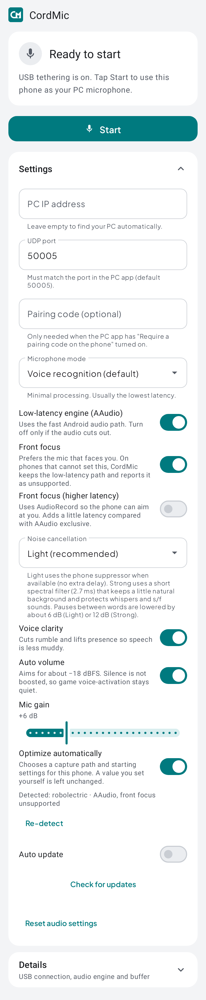 | 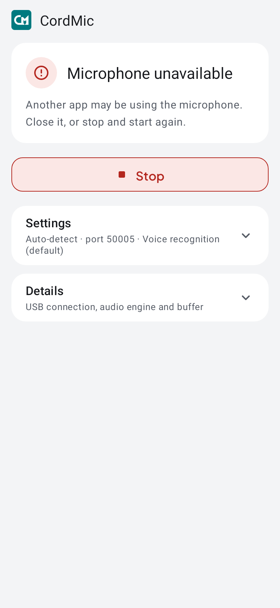 |

| Tema gelap | Bahasa Indonesia | Layar kecil (320 dp) |
|---|---|---|
| 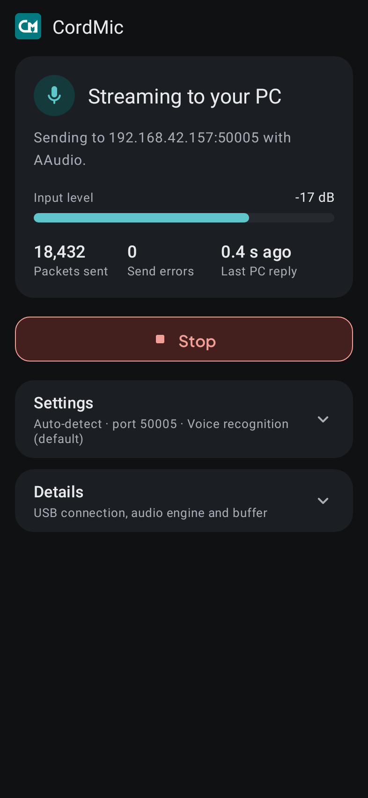 | 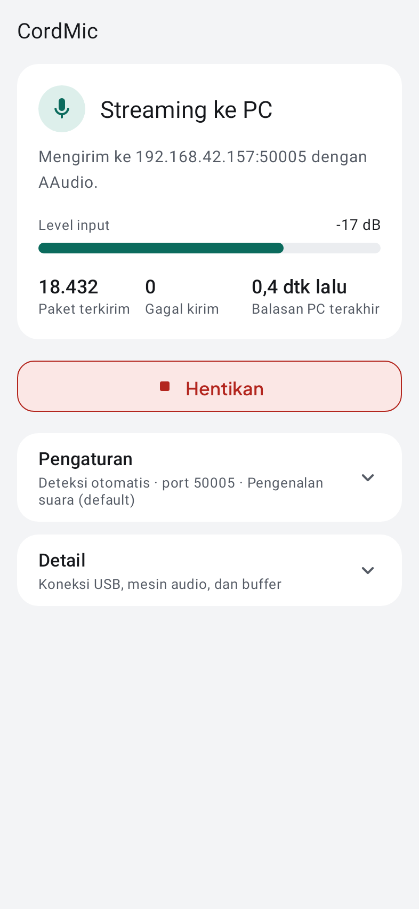 | 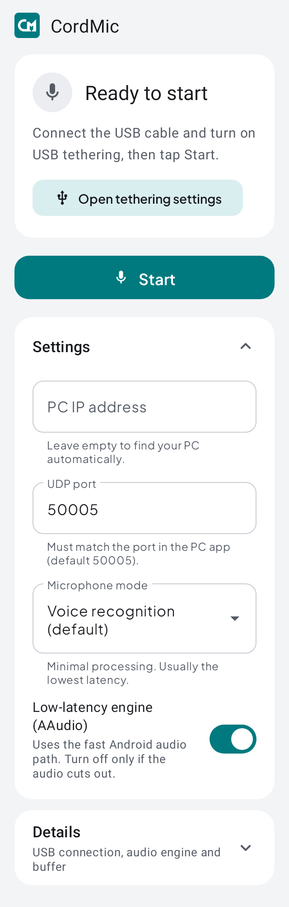 |

Lanskap: [android-landscape.png](docs/screenshots/android-landscape.png).

**Aplikasi Windows.** Jendela sambung di bawah adalah render tata letak header dan tombol sambung 0.5.1
(lingkungan ini tidak bisa menjalankan WinForms), memakai logo, ikon, Plus Jakarta Sans, dan warna aplikasi,
dengan nilai contoh. Ini bukan tangkapan dari aplikasi yang sedang berjalan. Gambar lama adalah
pratinjau desain panduan 0.4.

| Jendela sambung |
|---|
| 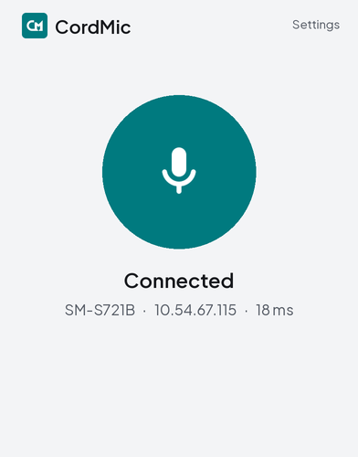 |

| Pengaturan: Suara (render 0.7.0) | Pengaturan: Pembaruan (render 0.7.0, Inggris) |
|---|---|
| 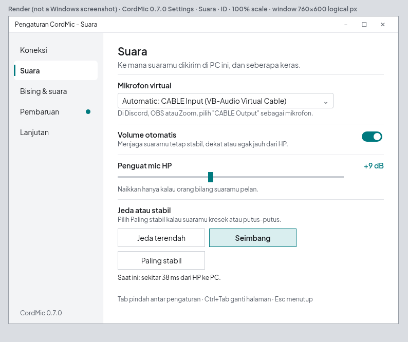 | 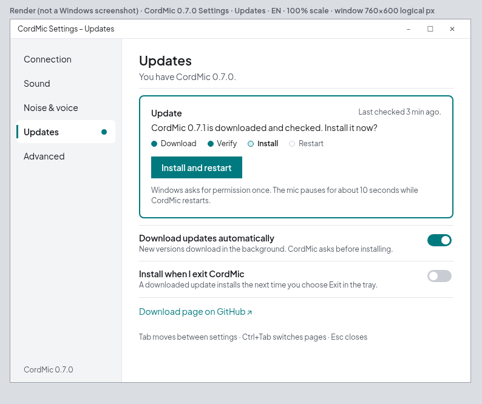 |

Gambar Pengaturan adalah render dari `tools/render/render_settings.py` berdasarkan katalog, teks, dan konstanta tata
letak aplikasi, dengan nilai contoh; bukan tangkapan layar aplikasi yang berjalan.

| Panduan, streaming (pratinjau 0.4) | Panduan, menunggu (pratinjau 0.4) | Menu tray dan tooltip |
|---|---|---|
| 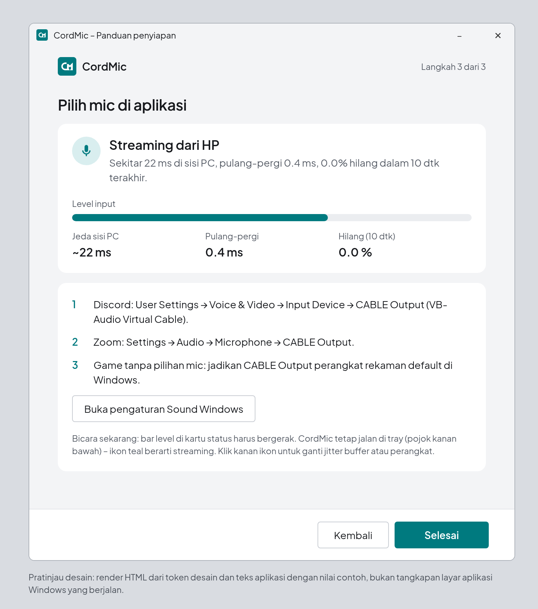 | 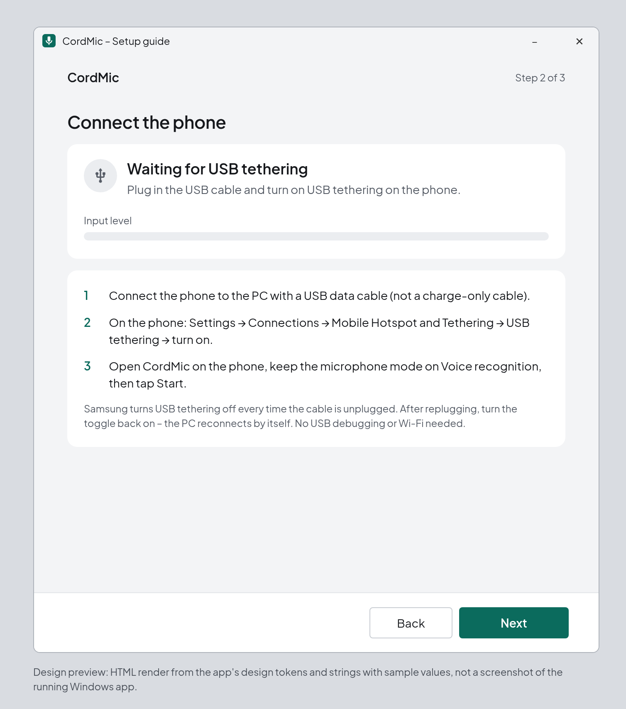 | 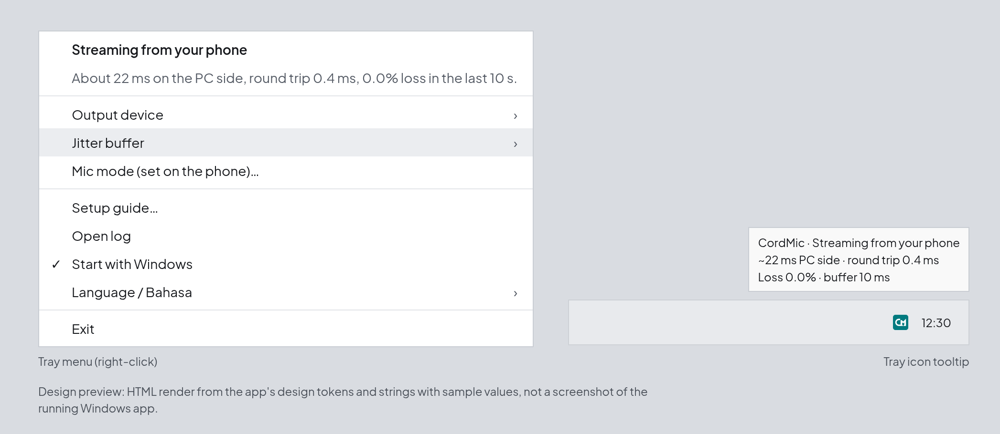 |

Lainnya: [langkah mic virtual](docs/screenshots/windows-wizard-cable-preview.png),
[versi Inggris](docs/screenshots/windows-wizard-streaming-preview.png).

## Kebutuhan

| | |
|---|---|
| PC | Windows 10 atau 11, 64-bit (x64) |
| HP | Android 10 atau lebih baru (minSdk 29) dengan USB tethering. Merek apa pun; pengaturan disesuaikan otomatis per perangkat |
| Kabel | Kabel USB **data** (kabel khusus charge tidak bisa) |
| Mic virtual | [VB-CABLE](https://vb-audio.com/Cable/) dari VB-Audio (donationware). Installer dan Pengaturan bisa mengunduh paket resminya; tidak pernah dibundel |

## Pasang & mulai cepat

Dari [rilis terbaru](https://github.com/Lukecinate/cordmic/releases/latest) unduh `CordMic-Setup-<versi>.exe`
(Windows) dan `CordMic-<versi>-release.apk` (Android). Build portable (`CordMic-Portable-<versi>.zip`) juga tersedia;
build ini tidak memasang aturan firewall, task adapter, atau VB-CABLE, jadi installer lebih disarankan.

1. **Pasang di PC.** Jalankan `CordMic-Setup-<versi>.exe` dan setujui UAC. Installer belum ditandatangani kode, jadi
   SmartScreen mungkin menampilkan "Windows protected your PC": klik **More info → Run anyway**. Bila belum ada
   perangkat CABLE, tugas opsional **Pasang VB-CABLE** sudah tercentang. Tugas ini mengunduh paket resmi VB-Audio
   lewat HTTPS, memeriksa SHA-256 yang dipatok (dan penanda tangan Authenticode bila bisa), lalu menjalankan setup
   VB-Audio sendiri yang menampilkan jendelanya sendiri. Reboot mungkin diperlukan. Aksi yang sama ada di
   Pengaturan → **Pasang VB-CABLE**.
2. **Pasang di HP dan sambungkan.** Salin APK ke HP lalu buka (izinkan "Install unknown apps" untuk file manager; di
   Samsung, matikan sementara Auto Blocker bila aktif). Colokkan kabel USB, nyalakan **USB tethering** (Samsung:
   *Pengaturan → Koneksi → Hotspot Seluler dan Tethering → USB tethering*), buka CordMic dan ketuk **Mulai**. HP
   menampilkan **Streaming ke PC** dan ikon tray berubah teal.
3. **Pilih mic di aplikasi.** Pilih **CABLE Output (VB-Audio Virtual Cable)** sebagai perangkat input, misalnya Discord:
   *User Settings → Voice & Video → Input Device*; Zoom: *Settings → Audio → Microphone*. Untuk game tanpa pilihan mic,
   jadikan CABLE Output perangkat rekam default di pengaturan Sound Windows.

CordMic sudah menargetkan suara sekitar −18 dBFS dengan puncak di −1 dBFS atau lebih rendah, jadi biarkan volume mic
aplikasi lain di sekitar **50–60 %**, bukan mendekati maksimum. Dengan voice activation (open mic) di game seperti
Valorant atau di Discord, pakai ambang sensitivitas sedang; nilai yang terlalu peka masih bisa terbuka oleh napas
atau suara keyboard. Bila memakai *Voice communication* di HP, matikan noise suppression dan echo cancellation
Discord agar suara tidak diproses dua kali.

Yang dilakukan installer:
- memasang ke `C:\Program Files\CordMic` dengan shortcut Start menu (opsional: jalan saat Windows mulai, shortcut desktop);
- menambah aturan firewall masuk **CordMic (UDP 50005)** untuk profil *Private*. Scheduled task di bawah menandai
  jaringan tethering HP sebagai *Private* dan membatasi aturan ke subnet jaringan itu saja (mulai 0.6.1; sebelumnya
  aturan mengizinkan seluruh subnet lokal di semua profil). Tanpa HP tersambung, aturan hanya mengizinkan `127.0.0.1`;
- menambah scheduled task `\CordMic\SetTetherMetric` (jalan sebagai SYSTEM saat boot, logon, dan saat jaringan
  berubah) yang mengatur **metric interface adapter HP menjadi 9999**, sehingga internet tetap lewat LAN/Wi-Fi dan
  link HP hanya membawa audio;
- menjalankan `CordMic.exe --configure-cable`, yang mengatur *CABLE Input* dan *CABLE Output* stereo ke 16-bit 48 kHz
  dan mematikan enhancement (dicadangkan dulu; lihat [docs/SECURITY.md](docs/SECURITY.md));
- opsional mengunduh dan menjalankan setup resmi VB-CABLE (lihat di atas).

Uninstall lewat *Settings → Apps → CordMic → Uninstall*. Ini memulihkan cadangan format VB-CABLE lalu menghapus
aplikasi, shortcut, autostart, aturan firewall, dan scheduled task. Pengaturan dan log di `%APPDATA%` /
`%LOCALAPPDATA%` tetap disimpan. VB-CABLE sendiri tidak dihapus.

## Aplikasi Windows

### Ikon tray

| Warna | Arti |
|---|---|
| Abu-abu | Menunggu USB tethering, atau *HP ditemukan* tetapi Mulai belum diketuk |
| Teal | Streaming dari HP, audio mengalir |
| Kuning tua | Perlu perhatian: belum ada mic virtual, HP tersambung tapi belum mengirim audio, atau internet PC lewat HP |
| Merah | Error: port UDP 50005 dipakai aplikasi lain, atau perangkat audio gagal dibuka (dicoba ulang otomatis) |

Arahkan kursor ke ikon untuk melihat rincian delay sisi PC (jaringan = ½ round trip USB, waktu tunggu jitter buffer
rata-rata, dan buffer output Windows terukur), plus round-trip time dan packet loss 10 detik terakhir.

### Jendela utama

Klik dua kali ikon tray (atau **Buka CordMic**). Jendela berisi satu tombol bulat (terputus, mencari, tersambung,
error; bisa difokuskan dan ditekan dengan Enter atau Spasi), baris status dengan model HP dan delay sisi PC, serta
tautan **Pengaturan**. Ikon roda gigi di header membuka jendela Pengaturan yang sama dan menampilkan titik teal bila
pembaruan sudah diunduh dan siap. Esc menutup jendela, Ctrl+, membuka Pengaturan.

### Jendela Pengaturan (0.7.0)

Satu jendela dengan lima halaman di kiri. Setiap pengaturan punya label dengan bahasa sehari-hari dan satu baris
penjelasan. Halaman bisa digulir bila jendela kecil, jendela dibuka paling besar 90% layar, dan tata letaknya
mengikuti DPI jendela (100–200%). Keyboard: Tab / Shift+Tab antar pengaturan, tombol panah di dalam grup,
Ctrl+Tab / Ctrl+Shift+Tab (atau Ctrl+PageDown / PageUp) antar halaman, Esc menutup.

| Halaman | Pengaturan | Default |
|---|---|---|
| Koneksi | Status HP; Minta kode pairing (dengan Kode baru); Jalan saat Windows mulai; Bahasa (Otomatis, English, Bahasa Indonesia) | Pairing mengikuti pengaturan sebelumnya; Jalan saat Windows mulai mati; Otomatis |
| Suara | Mikrofon virtual (Otomatis = kabel virtual terbaik yang ditemukan: VB-CABLE A–D, VAC, VoiceMeeter, atau perangkat tertentu); Pasang VB-CABLE (hanya bila belum ada kabel); Volume otomatis; Penguat mic HP 0 sampai +24 dB; **Jeda atau stabil**: Jeda terendah / Seimbang / Paling stabil, dengan jeda HP-ke-PC saat ini | Otomatis; Volume otomatis aktif; +6 dB; Seimbang |
| Bising & suara | **Peredam bising**, satu pilihan: Mati, HP – ringan (disarankan), HP – kuat, Studio PC – seimbang / bisikan / maksimal (+40 ms, lihat [Peredam bising Studio di PC](#peredam-bising-studio-di-pc-opsional)); Kejelasan suara; Fokus depan; Mikrofon HP (info dari HP) | HP – ringan; Kejelasan suara aktif; Fokus depan aktif |
| Pembaruan | Kartu pembaruan (status, progres, Batal, satu tombol utama); Unduh pembaruan otomatis; Pasang saat aku keluar dari CordMic; Halaman unduhan di GitHub | Unduh otomatis **aktif**; pasang saat keluar mati |
| Lanjutan | Jitter buffer (Low 5 / Normal 10 / Safe 20 ms); Mode output Windows (Auto, Latensi rendah, Stabil, Exclusive); Fokus depan, mode kompatibel (AudioRecord, latensi lebih tinggi); Optimalkan VB-CABLE; Perbaiki prioritas jaringan HP; Mode mic diatur di HP; Dapatkan VB-CABLE; Buka log; Reset pengaturan audio | Normal; Auto; mati |

*Jeda atau stabil* mengatur jitter buffer dan mode output sekaligus: Jeda terendah = Low + Auto, Seimbang =
Normal + Auto, Paling stabil = Safe + Stabil. Bila kombinasi lain dipilih di Lanjutan, ketiganya tidak terpilih dan muncul catatan bahwa nilai khusus diatur di Lanjutan.
*Mode output Auto* memilih periode stabil terpendek dan mencoba Exclusive hanya bila lebih pendek; pilihan eksplisit
tidak pernah ditimpa. Pengaturan dari 0.6.x dimigrasikan saat pertama kali dibuka dan tidak ada yang hilang.

Pengaturan suara yang diubah di sini langsung diterapkan ke HP, dan perubahan di HP muncul di sini. Kontrol yang
sedang fokus, digeser, atau terbuka tidak ditimpa nilai yang masuk. Peringatan muncul bila suara tetap di bawah
sekitar −40 dBFS setelah gain. Di bawah Peredam bising bisa muncul dua pemberitahuan lain: *Dekatkan HP (sekitar
15 cm) agar suara lebih bersih* bila perkiraan rasio suara-terhadap-noise tetap di bawah 15 dB selama 10 detik
(hilang lagi di atas 18 dB selama 10 detik), dan peringatan bila Android melaporkan bahwa aplikasi lain membuat mic
CordMic hening.

Klik kanan ikon tray untuk **Buka CordMic**, **Hubungkan / Putuskan**, **Pengaturan…**, **Periksa pembaruan**
(tampil sebagai **● Pasang CordMic x.y.z** berwarna teal bila pembaruan siap), **Perbaiki prioritas jaringan HP**
(hanya muncul bila internet lewat HP; meminta UAC), **Buka log**, dan **Keluar**.

### Pengaturan dan log

| Apa | Lokasi |
|---|---|
| Pengaturan | `%APPDATA%\CordMic\settings.json` |
| Log aplikasi (statistik tiap 10 detik saat tersambung) | `%LOCALAPPDATA%\CordMic\logs\cordmic.log` |
| Log helper VB-CABLE | `%LOCALAPPDATA%\CordMic\logs\cable-helper.log` |
| Cadangan format VB-CABLE | `%ProgramData%\CordMic\cable-format-backup.json` |
| Log installer / task metric | `C:\ProgramData\CordMic\` |

Contoh baris statistik (arti kolom ada di [Receiver Python](#receiver-python-alat-developer)):

```
stats peer=… rx=… lost=0 (0.00%) late=0 plc=0 underrun=… ovf=… buf=…ms jitter=…ms rtt=…ms bufavg=…ms bufmin=…ms
      slip=… period=2.7ms jtarget=15.0ms/3pkt urate=…/min orate=…/min nc=light agc=on gain=+6dB phone=AAudio-excl dir=…
      mics=… floor=-62dBFS gate=closed agcgain=+8.5dB exp=-6.0dB drift=…ppm uplc=… studio=off studiocpu=-
      studiogain=-dB snr=…dB silenced=0 devns=0 dev=…
```

Sejak 0.5.7, HP versi 0.5.7 juga melaporkan rantai suaranya: `floor` = level noise latar yang diukur sebelum gain mic
(`~` sampai jeda pertama terukur), `gate` = gate Volume otomatis (`open` saat bicara), `agcgain` = makeup Volume
otomatis saat ini (`off` bila Volume otomatis mati), `exp` = gain expander jeda saat ini. Dengan HP versi lama
kolom-kolom ini berisi `-`.

Sejak 0.6.0: `drift` = selisih clock yang dikoreksi resampler, `uplc` = frame underrun yang diisi penyamaran,
`studio` = status Studio (`off`, nama preset, `-fallback`, `-unavailable`, atau `-nophoneack` bila HP belum
mengonfirmasi bypass), `studiocpu` = waktu proses Studio per frame 10 ms, `studiogain` = gain Volume otomatis Studio,
`snr` = perkiraan rasio suara-terhadap-noise untuk pemberitahuan dekatkan HP, `silenced` = Android membuat capture HP
hening, `devns` = HP menduga ada peredam noise tersembunyi dari perangkat (hanya dicatat).

`jtarget` adalah target yang sedang dipakai, termasuk kenaikan adaptif (0.5.6). `urate` / `orate` adalah
underrun dan overflow drop per menit.

## Aplikasi Android

Layarnya satu kartu status dan satu tombol. Kartu menjelaskan apa yang terjadi (*Siap dimulai*, *Menunggu USB
tethering*, *Mencari PC*, *Streaming ke PC*, *Mikrofon tidak tersedia*) dan memberi satu langkah berikutnya, misalnya
**Buka pengaturan tethering**. Saat streaming, kartu menampilkan level input (setelah gain, sama dengan yang diterima
PC), paket terkirim, error kirim, dan umur balasan PC terakhir.

1. Nyalakan USB tethering (lihat di bawah).
2. Periksa **Pengaturan**:

   | Pengaturan | Default | Catatan |
   |---|---|---|
   | Alamat IP PC | kosong (otomatis) | Biarkan kosong agar PC ditemukan otomatis |
   | Port UDP | 50005 | Harus sama dengan aplikasi PC |
   | Mode mikrofon | Voice recognition | *Voice recognition* (pemrosesan minimal, biasanya latensi terendah), *Unprocessed* (mentah), *Voice communication* (NS/AEC/AGC bawaan, menambah latensi) |
   | Engine latensi rendah (AAudio) | Aktif | Mencoba exclusive low-latency, lalu shared low-latency, lalu shared; cadangannya AudioRecord |
   | Optimalkan otomatis | Aktif | Memilih jalur capture dan pengaturan awal untuk HP ini; nilai yang diatur pengguna tidak pernah ditimpa. **Deteksi ulang** menjalankan pemeriksaan lagi |
   | Noise cancellation | Ringan | Ringan memakai peredam bawaan HP bila ada (tanpa delay tambahan), bila tidak memakai filter Ringan CordMic. Kuat memakai filter spektral CordMic (2,7 ms). Keduanya menurunkan jeda antarkata (sekitar 6 / 12 dB) |
   | Voice clarity | Aktif | Memotong dengung, menonjolkan presence |
   | Volume otomatis | Aktif | Menuju −18 dBFS; jeda tidak dikuatkan |
   | Fokus depan | Aktif | Memilih mic yang menghadap pengguna |
   | Fokus depan (latensi lebih tinggi) | Mati | Memakai AudioRecord agar arah bisa diterapkan |
   | Gain mic | +6 dB | 0 sampai +24 dB |
   | Pembaruan otomatis / Periksa pembaruan | Pembaruan otomatis mati | Lihat [Pembaruan](#pembaruan) |
   | Reset pengaturan audio | – | Mengembalikan default suara |

   IP PC, port, mode mikrofon, dan sakelar AAudio dikunci saat streaming. Pengaturan suara tetap bisa diubah
   langsung dan disinkronkan dengan PC.
3. Ketuk **Mulai** dan beri izin Mikrofon dan Notifikasi. Notifikasi "CordMic" permanen (dengan tombol Stop) menjaga
   capture tetap jalan saat layar mati atau saat memakai aplikasi lain. **Detail** menampilkan engine capture, mode
   sharing dan performa, sample rate, ukuran burst dan buffer, overrun, interface USB, dan versi aplikasi. Baris
   **Detected:** meringkas hasil pemeriksaan perangkat.
4. Di HP dengan manajemen baterai agresif, izinkan penggunaan background tanpa batas (Samsung:
   *Pengaturan → Aplikasi → CordMic → Baterai → Tidak dibatasi*, dan pastikan CordMic tidak ada di "Aplikasi tidur").

Aplikasi mengikuti tema terang/gelap dan bahasa sistem (Inggris atau Indonesia). Android 14+ hanya mengizinkan
foreground service mikrofon dimulai saat aplikasi terlihat, jadi **Mulai** harus diketuk dari layar aplikasi dan
layanan tidak mulai sendiri setelah reboot.

### Deteksi perangkat otomatis

Saat aplikasi dibuka, saat headset/USB/Bluetooth mic dicolok atau dicabut, dan saat sesi dimulai, HP memeriksa level
API dan model, mikrofon bawaan, dukungan AAudio low-latency dan exclusive, noise suppression / AGC / AEC bawaan, API
arah mikrofon, preset input, rate dan burst bawaan, capture stereo, dan level input beberapa detik pertama. Tidak ada
polling. Dari hasilnya, aplikasi memilih AAudio exclusive bila diizinkan, lalu AAudio shared, lalu AudioRecord;
memakai preset Voice recognition; menyalakan Fokus depan; memakai noise cancellation Ringan; dan mengatur gain awal
dari level terukur. Pemeriksaan tetap di perangkat; hanya ringkasan kemampuan singkat dan nama model yang dikirim ke
PC lewat link yang sama.

### USB tethering
1. Sambungkan HP dengan kabel USB data.
2. Nyalakan USB tethering. Samsung: **Pengaturan → Koneksi → Hotspot Seluler dan Tethering → USB tethering**. HP lain
   biasanya di *Jaringan & internet → Hotspot & tethering*. Sakelarnya abu-abu sampai kabel tersambung. USB debugging
   **tidak** diperlukan.
3. Windows menampilkan adapter baru, biasanya "Remote NDIS based Internet Sharing Device" atau "UsbNcm".

## Pemrosesan suara

Semua pemrosesan suara berjalan di HP sebelum paket dikirim. Rantainya sama di Kotlin (`VoiceChain.kt`) dan di
implementasi referensi C# (`CordMic.Core/VoiceChain.cs`) yang memuat test.

1. **Voice clarity** (opsional): high-pass 120 Hz, low shelf −5 dB di 220 Hz, presence +2,5 dB di 3 kHz.
2. **Peredam noise**: Ringan memakai `NoiseSuppressor` bawaan bila ada; selain itu (dan untuk Kuat) STFT 256 titik
   dengan jendela Hann dan overlap 50 % (delay 2,67 ms). Tiap bin memakai gain Wiener dari estimasi SNR
   decision-directed, dihaluskan antar-bin tetangga dan terhadap waktu (lebih cepat membuka daripada menutup), dengan
   batas bawah −10 dB (Ringan) atau −15 dB (Kuat) sehingga sedikit suara latar alami tetap ada dan sisa desis tidak
   bergetar. Estimasi noise cepat mengikuti bagian yang lebih tenang dan hanya naik sekitar 3 dB/detik di luar itu,
   sehingga suara bicara, bisikan, dan konsonan desis tidak ikut dianggap noise. Selama pita di atas 3 kHz jelas di atas
   noise-nya, bin tersebut dijaga minimal −4,4 dB agar bunyi s/f/sy dan bisikan tetap terdengar di mode Kuat.
3. **Gain mic**, berubah bertahap sekitar 20 ms saat diatur.
4. **Gate dan lantai noise**, diukur sebelum gain. Lantai dilacak terus-menerus (turun dalam sekitar 0,3 detik, naik
   paling cepat 1,5 dB/detik saat jeda). Gate terbuka sekitar 10 dB dan tertutup sekitar 4 dB di atas lantai, dengan
   tahan 200 ms.
5. **Volume otomatis**: selubung RMS (~40 ms) diarahkan ke −18 dBFS; makeup dibatasi agar lantai tetap di −52 dBFS
   atau lebih rendah setelah gain, dan kembali ke unity saat jeda.
6. **Expander jeda**: sekitar −6 dB (Ringan) atau −12 dB (Kuat) saat gate tertutup.
7. **Limiter puncak** di −1 dBFS.

### Peredam bising Studio di PC (opsional)

Mati secara default. Saat preset Studio dipilih di PC, PC meminta HP (flag PING, HP versi 0.6.0) melewati peredam
noise, gate, Volume otomatis, dan expander jeda miliknya, sehingga peredaman tidak diterapkan dua kali. Gain mic, Voice
clarity, dan limiter tetap di HP. Pengaturan yang tersimpan di HP tidak berubah dan berlaku lagi begitu Studio
dimatikan. Di PC, sebuah worker thread (bukan callback audio) menjalankan:

1. **RNNoise** (BSD-3, `rnnoise.dll` native) di 48 kHz, berdampingan dengan salinan peredam Kuat 0.5.7 di PC yang
   diselaraskan dengan delay RNNoise 20 ms.
2. **WhisperGuard** mencampur kembali ke keluaran Kuat saat RNNoise membuang sinyal yang jelas ada (bisikan atau
   konsonan lembut). *Seimbang* (preset default), *Prioritas bisikan* (lebih banyak dicampur kembali, bisikan paling
   terjaga) dan *Maksimal* (hanya RNNoise, pembersihan paling kuat, bisikan bisa menipis). Sejak 0.6.2 guard baru
   terbuka setelah sinyal ada selama 300 ms (atau RNNoise mendeteksi suara) dan melepas dalam sekitar 200 ms, sehingga
   benturan singkat tidak membuatnya hidup-mati.
3. **Volume otomatis (B3)**, bila Volume otomatis aktif: berbasis loudness (LUFS), menuju −21 LUFS, dibekukan saat
   jeda, dengan limiter −1 dBFS. Gain dibatasi agar latar yang dikuatkan tetap di −60 dBFS atau lebih rendah. Gain-nya
   diingat antarsesi, paling tinggi +15 dB.
4. **Lantai nyaman** (0.6.2): lapisan noise sangat pelan, 55 dB di bawah loudness ucapan keluaran (paling tinggi −65 dBFS dan di bawah noise ruangan), sehingga jeda tidak pernah
   jatuh ke sunyi digital dan lompatan antara ucapan dan jeda tetap kecil.

Tambahan latensi sekitar 40 ms (RNNoise 20 ms ditambah dua frame worker 10 ms; satu frame sebelum 0.6.2). Pemrosesan memakan sekitar 0,55 ms
per frame 10 ms di mesin build tanpa alokasi per frame. Bila buffer worker kurang saat diambil render, celahnya diisi
dengan mengulang periode pitch terakhir (dicatat sebagai `studiounder=` / `studiomiss=` di log), bukan sunyi singkat.
Mengganti preset Studio berpindah langsung tanpa membangun ulang jitter buffer. Selama tidak ada HP yang terhubung,
worker Studio dijeda. Bila worker melewatkan 3 tenggat dalam 1 detik, Studio mati
untuk sesi itu, pemberitahuan muncul, dan peredam noise HP dipakai lagi. Dengan HP versi lebih lama dari 0.6.0, PC
menampilkan bahwa HP belum mengonfirmasi bypass.

## Pembaruan

Kedua aplikasi punya **Periksa pembaruan**. CordMic membaca GitHub Release terbaru `Lukecinate/cordmic` lewat HTTPS
tanpa akun, memverifikasi file unduhan dengan `SHA256SUMS` rilis, dan tidak pernah memasang versi lebih lama. Tidak
ada data lain yang dikirim.

**Windows (0.7.0).** *Unduh pembaruan otomatis* aktif secara default (juga untuk pengguna lama, kecuali sengaja
dimatikan di 0.6.1 atau lebih baru). CordMic memeriksa saat dibuka dan sekitar tiap enam jam, mengunduh versi baru di
latar belakang dengan progres, memverifikasinya, lalu bertanya dulu: ikon tray menampilkan notifikasi, menu tray
menampilkan **● Pasang CordMic x.y.z**, dan roda gigi menampilkan titik teal. Tidak ada yang dipasang tanpa klik.
**Perbarui sekarang** di Pengaturan → Pembaruan mengunduh, memverifikasi, memasang, dan memulai ulang sekaligus;
**Batal** menghentikan pemeriksaan atau unduhan. Bila *Pasang saat aku keluar dari CordMic* aktif, pembaruan yang
siap dipasang saat kamu memilih Keluar di tray. Hanya satu pemeriksaan atau unduhan yang berjalan pada satu waktu.
Unduhan disimpan di folder privat bernama acak (hanya bisa dibaca pengguna saat ini), dan checksum dihitung pada
handle file terkunci yang sama yang kemudian dijalankan atau diekstrak. Sejak 0.7.1 pembaruan yang sudah
diverifikasi tetap tersimpan setelah restart: saat dibuka CordMic memeriksa ulang folder dan checksum lalu langsung
menawarkan **Pasang**; bila file hilang atau berubah, file diunduh ulang saat itu juga.

- *Salinan terpasang*: `CordMic-Setup-<versi>.exe` yang sudah diverifikasi dijalankan dengan `/S`; Windows meminta
  izin sekali (UAC; SmartScreen juga bisa muncul karena installer belum ditandatangani Authenticode). Mic berhenti
  sekitar 10 detik selama CordMic dimulai ulang.
- *Salinan portabel* (folder dengan `portable.txt`, atau tanpa `Uninstall.exe`): `CordMic-Portable-<versi>.zip`
  yang sudah diverifikasi diekstrak, lalu helper kecil (`CordMic.exe --apply-portable-update` dari versi baru)
  menunggu CordMic keluar, mengganti file di tempat dengan cadangan, mengembalikan semuanya bila ada file yang gagal,
  lalu membuka CordMic lagi. Tanpa permintaan izin. Bila folder tidak bisa ditulis (misalnya di Program Files),
  CordMic memberi tahu dan menautkan halaman unduhan.
- Pesan error memakai kalimat biasa (tidak ada internet, checksum tidak cocok, izin ditolak, folder tidak bisa
  ditulis) dengan tautan ke halaman unduhan di GitHub.

**Android.** Sakelar opsional **Pembaruan otomatis** (default mati) memeriksa saat aplikasi dibuka dan sekitar tiap
enam jam. Android juga mewajibkan sertifikat penanda tangan APK sama dengan aplikasi terpasang lalu menyerahkan file
ke installer sistem (Install diketuk sekali; "install unknown apps" mungkin diminta).

## Troubleshooting

| Gejala | Coba |
|---|---|
| Ikon tetap abu-abu, "Menunggu USB tethering" | Pakai kabel **data**. Nyalakan lagi USB tethering (banyak HP mematikannya setiap kabel dicabut). *Settings → Network* Windows harus menampilkan adapter "Remote NDIS…" / "UsbNcm…" |
| "HP ditemukan" tapi tidak streaming | Buka CordMic di HP dan ketuk *Mulai*. Pastikan aturan firewall *CordMic (UDP 50005)* ada (jalankan ulang installer bila hilang) |
| Merah, "Port dipakai" | Receiver lain (mis. `cordmic_receiver` Python) sedang jalan. Tutup; CordMic mencoba lagi tiap 5 detik |
| Kuning tua, "Belum ada mic virtual" | Pakai **Pasang VB-CABLE** di Pengaturan; restart PC bila perangkat belum muncul |
| Kresek atau putus sesaat | Periksa `underrun` / `ovf` / `urate` di log. Sejak 0.5.6 target naik sendiri setelah underrun berulang; bila masih terjadi, pilih *Latensi → Safe (20 ms)* lalu *Mode output → Stabil*. Hindari USB hub |
| Studio mati sendiri | PC tidak sanggup mengikuti (3 tenggat terlewat dalam 1 detik). Tutup aplikasi latar yang berat, atau pakai peredam noise HP |
| Suara terdengar jauh atau keruh | Ikuti pemberitahuan *Dekatkan HP*: sekitar 15 cm. Peredam noise tidak bisa menghapus gema ruangan |
| Peringatan "mic dibuat hening" | Aplikasi lain (sering asisten suara atau perekam) mengambil mic. Tutup aplikasi itu |
| Desis di antara kata | Biarkan noise cancellation di Ringan atau Kuat (keduanya menurunkan jeda), turunkan Gain mic dan biarkan Volume otomatis bekerja. Pakai ambang voice activation game yang sedang. Kolom `floor` di log menunjukkan level latar HP (di atas sekitar −50 dBFS berarti ruangan bising atau Gain mic terlalu tinggi) |
| Suara terlalu pelan | Dekatkan HP, naikkan Gain mic beberapa dB, dan biarkan Volume otomatis aktif. Peringatan muncul di bawah sekitar −40 dBFS |
| Fokus depan "unsupported" | Jalur AAudio HP tidak punya API arah. Nyalakan *Fokus depan (latensi lebih tinggi)* untuk memakai AudioRecord, atau biarkan mati untuk latensi terendah |
| Ping game naik setelah HP dicolok | *Perbaiki prioritas jaringan HP* di menu tray (atau jalankan `C:\Program Files\CordMic\tools\set-tether-metric.ps1` sebagai administrator), atau matikan data seluler HP |
| Discord tidak mendengar apa-apa | Perangkat input harus **CABLE Output** (bukan CABLE Input) |
| Suara terlalu diproses atau terlambat | Pakai *Voice recognition* di HP. Dengan *Voice communication*, matikan noise suppression dan echo cancellation Discord |
| Pemeriksaan pembaruan gagal | PC atau HP perlu akses internet lewat koneksi biasanya (bukan link tethering). File juga bisa diunduh dari halaman Releases |

Perbaikan metric manual (PowerShell sebagai administrator):
```powershell
Get-NetAdapter                                                  # find the phone adapter, e.g. "Ethernet 3"
Set-NetIPInterface -InterfaceAlias "Ethernet 3" -InterfaceMetric 9999
Get-NetRoute 0.0.0.0/0                                          # the default route should use LAN/Wi-Fi
```

Saat melaporkan masalah, lampirkan `cordmic.log` dan sebutkan model HP, baris **Detected:**, serta pengaturan yang
dipakai. Jangan melampirkan rekaman suara di issue publik.

## Keterbatasan yang diketahui

- **Installer Windows belum ditandatangani.** Installer dan `CordMic.exe` belum Authenticode-signed, jadi SmartScreen
  memperingatkan saat pertama dijalankan. Verifikasi unduhan dengan `SHA256SUMS` dari rilis.
- **USB tethering harus dinyalakan manual.** Android tidak mengizinkan aplikasi biasa menyalakan tethering, dan banyak
  HP mematikannya saat kabel dicabut. Sisi PC menyambung ulang otomatis setelah dinyalakan lagi.
- **Perlu kabel virtual.** Windows hanya menampilkan mikrofon dari driver audio, dan aplikasi mode pengguna tidak bisa
  membuatnya. CordMic memutar audio ke kabel virtual yang sudah ada (lihat [Roadmap](#roadmap)).
- **Fokus depan di jalur AAudio.** AAudio tidak punya API arah mikrofon, jadi di jalur latensi rendah pengaturan ini
  dilaporkan unsupported kecuali memakai *Fokus depan (latensi lebih tinggi)*.
- **Tanda tangan APK.** Sejak 0.3.1 APK rilis ditandatangani dengan kunci rilis proyek (sertifikat
  `CN=CordMic, O=CordMic contributors`, SHA-256
  `2c:da:64:ae:df:4e:ba:6f:9d:4a:fa:06:e6:85:43:04:65:a6:0d:5d:2a:25:ef:99:ee:f3:cc:16:3e:47:1c:8b`). APK
  didistribusikan di luar Google Play. Versi 0.3.0 memakai kunci debug; uninstall dulu sebelum memasang versi berikutnya.
- **Round-trip time hanya dari sisi PC.** HP menjawab PING dari PC tetapi tidak mengukurnya, jadi aplikasi HP
  menampilkan umur balasan PC terakhir.
- **Latensi dan loudness Studio.** Peredam bising Studio di PC menambah sekitar 40 ms, lebih dari target 12 ms di
  rencana 0.6.0, karena itu sifatnya opsional. Bisikan bisa tetap beberapa LU di bawah target −21 LUFS, dan bunyi
  hentakan seperti bus atau keyboard masih bisa terdengar saat jeda dengan Seimbang (Maksimal menghindarinya).
- **Pemeriksaan perangkat belum dilakukan di hardware.** Peringatan mic dibuat hening dan capture privacy-sensitive
  mengikuti dokumentasi Android tetapi belum diuji di HP untuk rilis ini.
- **Aturan mulai Android 14+.** Capture harus dimulai dari aplikasi yang terlihat; tidak mulai saat boot.

## Privasi dan keamanan

- Audio hanya lewat link USB tethering ke PC di subnet lokal; CordMic tidak menyimpannya.
- Pemeriksaan perangkat berjalan di HP. Hanya ringkasan kemampuan singkat dan nama model yang dikirim ke PC.
- Tidak ada telemetri atau analitik. Permintaan internet hanya pemeriksaan dan unduhan pembaruan (GitHub Releases;
  di Windows otomatis secara default dan bisa dimatikan) serta unduhan VB-CABLE opsional dari vb-audio.com, semuanya
  lewat HTTPS.
- Aplikasi tray berjalan sebagai pengguna yang login. Pengubahan format VB-CABLE memakai mode helper ber-elevasi
  dengan perintah tetap; lihat [docs/SECURITY.md](docs/SECURITY.md) untuk apa yang diubah dan cara membatalkannya.

## Arsitektur & protokol

```
┌──────────────── Android phone ───────────────┐   USB cable     ┌──────────────── Windows PC ──────────────────┐
│ Mic → AAudio exclusive / shared or           │ (USB tethering, │ CordMic tray app (.NET 8)                    │
│       AudioRecord (48 kHz mono s16, 5 ms)    │  RNDIS/NCM =    │  UDP :50005 → jitter buffer                  │
│   → clarity EQ, noise suppression, gain,     │  network link)  │    (period-aware, adaptive, drift lock)      │
│     gate, Auto volume, expander, limiter     │ ──────────────▶ │  → own WASAPI renderer (IAudioClient3,       │
│   → 20-byte header (seq + timestamp)         │                 │    shared or exclusive) → "CABLE Input"      │
│ Foreground service type=microphone           │ ◀── HELLO/PING  │  Discord/Zoom/games use "CABLE Output"       │
│ + device probe + persistent notification     │                 │  as their microphone                         │
└──────────────────────────────────────────────┘                 └──────────────────────────────────────────────┘
```

- **Transport.** USB tethering membuat HP muncul sebagai adapter jaringan kabel di Windows (driver RNDIS/NCM bawaan).
  Tanpa ADB, Wi-Fi, atau USB debugging.
- **Penemuan.** Saat tethering aktif, HP menjadi gateway/server DHCP. Aplikasi mencari interface tethering
  (`rndis0` / `ncm0` / `usb0`) dan mem-broadcast **DISCOVER**; PC membalas **HELLO** (aplikasi Windows juga mengirim
  HELLO ke gateway saat melihat adapter tethering), lalu HP streaming unicast ke PC. IP PC juga bisa diisi manual.
- **Keep-alive, kontrol, dan sambung ulang.** PC mengirim **PING** tiap 500 ms dari socket dan thread terpisah; HP
  menjawab **PONG**. PING membawa pengaturan suara dari PC, PONG melaporkan keadaan HP. Bila HP tidak mendengar apa
  pun selama 3 detik, atau socket gagal setelah kabel dicabut, HP kembali ke penemuan. Stream capture yang terputus
  (mis. pergantian rute audio) dibuka ulang.
- **Header** (20 byte, little-endian; identik di `Protocol.kt`, `protocol.py`, dan `CordMic.Core`):

  | Offset | Size | Field |
  |---|---|---|
  | 0 | 2 | magic `"UM"` |
  | 2 | 1 | version (1) |
  | 3 | 1 | type: 1 AUDIO, 2 DISCOVER, 3 HELLO, 4 PING, 5 PONG, 6 BYE |
  | 4 | 4 | sequence number (uint32, wraps) |
  | 8 | 8 | timestamp in µs (sender's monotonic clock) |
  | 16 | 2 | PCM frame count |
  | 18 | 2 | flags: bits 0–3 codec (0 = PCM s16le), bits 4–7 channels − 1, bits 8–11 sample rate (0 = 48 kHz), bits 12–14 noise cancellation, AGC, AAudio |

  Payload AUDIO berupa PCM mentah: 240 frame × 2 byte = 480 byte per 5 ms (~100 kbit/s). PING/PONG membawa
  payload kontrol (magic `0xC5`): mode noise, voice clarity, AGC, fokus depan (kedua varian), dan gain di PING;
  engine, exclusive / low-latency, kode arah, jumlah mic, nama model, dan penanda level bicara di PONG. Sejak 0.5.5
  kedua sisi bisa menambahkan nomor urut dan asal per pengaturan agar perubahan terakhir yang berlaku. Sejak 0.5.7 PC
  memasang bit permintaan di blok itu, lalu HP menambahkan blok diagnostik 6 byte (magic `0xC7`: lantai sebelum gain,
  gate, gain AGC, gain expander, byte cek) di antara nama dan blok sinkronisasi. Blok ini hanya dikirim bila diminta
  dan hanya ke PC yang terhubung; tidak ada data yang keluar dari link USB. Aplikasi lama mengabaikan byte tambahan;
  versi wire tetap 1. 0.6.0 menambahkan bit Studio (bit 5) di flag PING dan tiga flag diagnostik (capture dibuat
  hening, bypass Studio aktif, dugaan peredam noise perangkat); peer lama mengabaikannya.
- **Jitter buffer.** Mengurutkan paket berdasarkan nomor urut. Sejak 0.6.0 paket hilang dan underrun disamarkan dengan
  mengulang periode pitch terakhir dengan crossfade 2 ms, level penuh selama 10 ms lalu memudar (hening setelah 30 ms
  kehilangan beruntun), dan clock drift dikoreksi oleh resampler kubik yang dikendalikan kontroler PI pada isi buffer,
  bukan slip sampel (kolom `slip` tetap 0). Sebelum 0.6.0 celah tunggal disamarkan dengan peluruhan singkat.
  Preset (Low 5 / Normal 10 / Safe 20 ms) dinaikkan minimal dua kali pengambilan render, atau tiga paket (15 ms) bila
  satu pengambilan hanya memakai satu paket (periode 2,7 ms). Overflow dipangkas ke satu periode di atas target;
  batas kerasnya target ditambah tiga periode render (lima untuk pengambilan satu paket). Drift lock tingkat sampel
  (kontroler PI lambat, slip dengan crossfade, ±150 ppm naik ke ±800 ppm untuk selisih clock yang menetap) menjaga
  kedalaman di target. Sejak 0.5.6 target naik satu paket setelah dua underrun dalam 10 detik (maksimal tiga paket)
  dan turun lagi setelah 60 detik tanpa underrun; underrun memudar dalam 2 ms dan dilanjutkan dengan ramp, dan
  pemangkasan overflow disambung dari sampel terakhir.
- **Output.** Loop WASAPI berbasis event milik CordMic pada thread MMCSS "Pro Audio". *Latensi rendah* membuka stream
  dengan IAudioClient3 pada periode shared minimum engine dan menulis paling banyak satu periode per callback;
  *Exclusive* memakai mode exclusive WASAPI pada periode minimum perangkat.

### Struktur repositori

```
cordmic/
├── android/                      Gradle project (Kotlin + C++/AAudio)
│   └── app/src/main/
│       ├── cpp/aaudio_capture.cpp  AAudio capture (JNI)
│       ├── java/dev/cordmic/     MainActivity, MicService, Streamer, Capture, VoiceChain, DeviceProbe,
│       │                         DeviceTune, SettingsSync, AppUpdate, UpdateInstaller, TetherNet, Protocol
│       └── res/values[-in]/      English and Indonesian strings (+ values-night for the dark theme)
├── docs/                         screenshots, logo (assets/), SECURITY.md, THIRD_PARTY_NOTICES.md
├── third_party/fonts/            Plus Jakarta Sans + OFL license
├── third_party/rnnoise/          rnnoise.dll (win-x64) + COPYING BSD-3 + SHA256SUMS
├── tools/brand/                  logo generator
├── tools/harness/                harness regresi (alat developer, tidak dikirim; data diunduh saat pengujian)
├── tools/rnnoise/                skrip build RNNoise yang dipin (zig cc)
├── windows-app/                  Windows app, C# / .NET 8
│   ├── src/CordMic.Core/         protocol, jitter buffer and policy, receiver, voice chain (reference),
│   │                             settings and sync, device tuning, update logic, string tables
│   ├── src/CordMic.App/          WinForms tray app, WASAPI renderer, VB-CABLE helper and installer, updater
│   ├── src/CordMic.Harness/      console receiver for loopback testing
│   ├── tests/CordMic.Tests/      xUnit tests (incl. interop with sim_sender.py)
│   ├── installer/                cordmic.nsi + tools/*.ps1 (firewall, adapter metric, VB-CABLE download)
│   └── build.sh                  test → publish win-x64 → installer
└── windows-receiver/             Python reference receiver + phone simulator (sim_sender.py)
```

## Latensi

Pipeline ini **dirancang untuk sekitar 30–45 ms end-to-end**. Ini anggaran rancangan, bukan hasil ukur: capture
~3–10 ms + paket 5 ms + link USB 1–2 ms + jitter buffer 10–15 ms + WASAPI/VB-CABLE ~3–20 ms, ditambah 2,7 ms bila
noise cancellation Kuat aktif, atau sekitar 40 ms bila peredam bising Studio di PC aktif. Latensi sebenarnya bergantung pada HP, jalur capture, dan stack audio PC.
*Fokus depan (latensi lebih tinggi)* dan *Voice communication* menambah delay capture.

**Delay sisi PC yang ditampilkan aplikasi:** jaringan (½ round trip) + jitter buffer (rata-rata waktu) + output
Windows (rata-rata isi buffer WASAPI CordMic yang terukur). Tidak termasuk capture HP, engine audio Windows, buffer
VB-CABLE sendiri, dan aplikasi perekam.

Untuk delay terendah: *Latensi → Low*, *Mode output → Auto* (atau *Exclusive*), noise cancellation Ringan, Voice
clarity dan Volume otomatis aktif, volume mic game/Discord 50–60 %, dan *Optimalkan VB-CABLE* agar "CABLE Input" dan
"CABLE Output" sama-sama 48 kHz stereo.

Cara mengukur: di OBS tambahkan dua sumber *Audio Input Capture*, (a) "CABLE Output" dan (b) mic fisik lain. Rekam,
tepuk tangan dekat **kedua** mic, lalu ukur jarak dua puncak tepukan di Audacity. Selisihnya adalah latensi CordMic
dikurangi latensi mic pembanding.

## Build dari source

### Aplikasi Windows dan installer
Perlu .NET 8 SDK, NSIS 3 (`makensis`), dan Python 3 (untuk test interop). Bisa di Windows (Git Bash/WSL), Linux, atau macOS:
```bash
cd windows-app && ./build.sh
```
Menjalankan test, mem-publish `windows-app/publish/CordMic.exe` (win-x64, self-contained, satu file) dan menulis
`dist/CordMic-Setup-<versi>.exe` serta `dist/CordMic-Portable-<versi>.zip` (isi `windows-app/publish/` ditambah
`portable.txt`, penanda salinan portabel untuk updater di aplikasi).

Render Pengaturan: WinForms tidak bisa berjalan di Linux, jadi `tools/render/render_settings.py` menggambar render
HTML/PNG berlabel dari katalog, teks, dan konstanta tata letak yang sama
(`dotnet run --project windows-app/src/CordMic.Harness -- settings-json id > id.json`, lalu
`python3 tools/render/render_settings.py id.json out/`). Ini render, bukan tangkapan layar.

### Aplikasi Android
Perlu JDK 17, Android SDK Platform 34 dan Build-Tools 34, NDK 26.1.10909125, dan CMake 3.22.1 (Android Studio atau
`sdkmanager`). Dibangun dengan AGP 8.5.2, Gradle 8.7, dan Kotlin 1.9.24.
```bash
cd android
echo "sdk.dir=/path/to/Android/Sdk" > local.properties   # Android Studio membuatnya otomatis
./gradlew testReleaseUnitTest assembleRelease
```
Penandatanganan rilis dibaca dari file properties di luar repositori (`storeFile`, `storePassword`, `keyAlias`,
`keyPassword`), lewat `CORDMIC_SIGNING_PROPERTIES=/path/file` atau `-PcordmicSigning=/path/file`. Tanpa itu, build rilis
lokal ditandatangani kunci debug, dan updater di aplikasi akan menolaknya sebagai pembaruan untuk instalasi resmi.

### Test
| Suite | Perintah | Cakupan |
|---|---|---|
| Python (24 test) | `cd windows-receiver && python -m unittest discover -s tests` | protokol, jitter buffer, callback output, UDP loopback (bersih dan lossy) |
| .NET (291 test) | `cd windows-app && dotnet test tests/CordMic.Tests` | vektor emas protokol, jitter buffer, simulasi kebijakan dan drift lock, target adaptif, kontinuitas underrun/overflow, voice chain dan kualitas (THD+N, klik, desis, fluktuasi gain Kuat, bisikan/konsonan tetap utuh), diagnostik HP, sinkronisasi pengaturan, tuning perangkat, pembaruan dan checksum, aturan VB-CABLE, backoff ping, UDP loopback, interop dengan `sim_sender.py`, tabel lokalisasi, vektor PLC/resampler 0.6.0 dan drift loop tertutup, delay RNNoise, CPU dan alokasi Studio, watchdog, WhisperGuard, Volume otomatis B3, pemberitahuan dekatkan HP, updater 0.7.0 dengan server rilis palsu (progres, batal, checksum tidak cocok, pemeriksaan bersamaan, tanpa downgrade), test regresi 0.7.1 (race pasang/periksa, pemulihan pembaruan siap setelah restart, watchdog, pembersihan, jadwal monotonik, skala font per DPI), deteksi portabel, penggantian file dan rollback, migrasi pengaturan, katalog dan tata letak Pengaturan pada DPI 100–200% |
| Kotlin (57 test) | `cd android && ./gradlew testReleaseUnitTest` | kompatibilitas header, voice chain (delay, ramp gain, limiter, gate sebelum gain, expander, fluktuasi gain Kuat, bisikan/konsonan tetap utuh), blok diagnostik, sinkronisasi pengaturan, parsing pembaruan, kesetaraan string Inggris/Indonesia, meter level, bypass Studio, flag diagnostik, panggilan arah mic yang dijaga, pemeriksaan peredam noise tersembunyi, render screenshot Robolectric (`-PrecordScreenshots` menulis ulang `docs/screenshots/android-*.png`) |

Gerbang rilis untuk peredam noise dan Volume otomatis (DNSMOS, ESTOI, PESQ, LUFS) dijalankan pada kode C# yang dikirim
melalui `tools/harness/` dengan data yang diunduh saat pengujian; lihat [tools/harness/README.md](tools/harness/README.md).

## Receiver Python (alat developer)

`windows-receiver/` berisi receiver referensi untuk pengembangan dan debugging protokol. Untuk pemakaian harian,
pasang aplikasi Windows (keduanya memakai UDP 50005, jadi jalankan salah satu saja).

```bat
cd windows-receiver
pip install -r requirements.txt
python -m cordmic_receiver --list-devices
python -m cordmic_receiver --device "CABLE Input" --jitter-ms 10
```

| Opsi | Default | Arti |
|---|---|---|
| `--device` | output default | indeks perangkat atau bagian namanya (mis. `"CABLE Input"`) |
| `--jitter-ms` | 10 | target jitter buffer |
| `--exclusive` | mati | mode exclusive WASAPI |
| `--blocksize` | 240 | ukuran blok callback (5 ms) |
| `--channels` | 2 | mono digandakan ke stereo |
| `--tray` | mati | ikon tray (pystray + pillow) |
| `--log file` | – | tulis log dan statistik ke file |
| `--no-audio` | mati | hanya terima dan cetak statistik |

Kolom statistik (sama dengan log aplikasi Windows): `lost` = celah nomor urut, `plc` = slot yang disamarkan, `late` =
paket yang datang setelah gilirannya, `underrun` = buffer kosong, `ovf` = paket dibuang karena buffer penuh, `jitter`
= jitter kedatangan (RFC 3550), `rtt` = round trip PING/PONG lewat USB, `slip` = penyesuaian sampel oleh drift lock
(aplikasi Windows memakai resampler sejak 0.6.0, jadi nilainya 0).

Tanpa HP, `python sim_sender.py --host 127.0.0.1 --seconds 10` mengirim nada uji 440 Hz (`--loss` dan `--jitter-ms`
mensimulasikan link buruk).

## Riwayat versi

| Versi | Sorotan |
|---|---|
| 0.7.1 | Teks mengikuti skala tiap monitor, pembaruan yang sudah diunduh tetap ada setelah restart, perbaikan dari audit updater dan jendela 0.7.0 |
| 0.7.0 | Jendela Pengaturan Windows baru (halaman, teks bantuan, bisa digulir, keyboard, DPI), unduhan pembaruan otomatis di latar belakang dengan Perbarui sekarang sekali klik, progres dan Batal, pembaruan mandiri versi portabel dengan rollback, menu tray lebih ringkas |
| 0.6.0 | Penyamaran packet loss berbasis pitch, kontrol drift dengan resampler, peredam bising Studio di PC opsional (RNNoise + WhisperGuard + Volume otomatis LUFS), peringatan mic dibuat hening, capture privacy-sensitive, pemberitahuan dekatkan HP |
| 0.5.7 | Peredam noise Kuat yang lebih halus (batas bawah spektral, penghalusan gain per pita, perlindungan bisikan dan konsonan); lantai noise, gate, gain Volume otomatis, dan expander HP tampil di log PC |
| 0.5.6 | Gate sebelum gain dan lantai noise yang dilacak terus, makeup AGC dibatasi lantai, expander jeda, ramp gain; underrun jitter buffer memudar, sambungan overflow halus, dan target adaptif |
| 0.5.5 | Fokus depan (latensi lebih tinggi) via AudioRecord, gate AGC relatif, pembaruan di aplikasi, pengaturan dua arah langsung, unduhan VB-CABLE resmi opsional |
| 0.5.4 | Fokus depan default aktif, deteksi perangkat di background, Optimalkan otomatis, baris Detected, AGC berbasis RMS |
| 0.5.3 | Drift lock tanpa hunting, peredam noise Hann-overlap, mode Ringan/Kuat, EQ voice clarity, keheningan tidak dikuatkan |
| 0.5.2 | CABLE Input stereo diutamakan, periode minimum IAudioClient3, Mode output Auto, Optimalkan VB-CABLE, drift lock tingkat sampel |
| 0.5.1 | Perbaikan tata letak jendela sambung |
| 0.5.0 | Target jitter mengikuti periode render, tulis satu periode, IAudioClient3, noise cancellation, gain mic dan AGC, jendela desktop satu tombol |
| 0.4.2 | Renderer WASAPI sendiri (tanpa NAudio), socket ping terpisah, pemangkasan antrean, delay sisi PC terukur |
| 0.4.1 | Logo baru |
| 0.4.0 | Aplikasi Android dan Windows didesain ulang dengan satu kartu status |

Rincian lengkap: [CHANGELOG.md](CHANGELOG.md).

## Upgrade dari UsbMic

CordMic sebelumnya bernama **UsbMic**. Protokol audio tidak berubah (header `UM`, UDP 50005).

- **Windows:** jalankan installer CordMic. Installer menutup `UsbMic.exe` dan menghapus aturan firewall lama, scheduled
  task `\UsbMic\SetTetherMetric`, entri startup, shortcut, `C:\Program Files\UsbMic`, dan entri uninstall lama.
  Pengaturan di `%APPDATA%\UsbMic` disalin ke `%APPDATA%\CordMic` saat pertama dijalankan.
- **Android:** nama paket berubah (`dev.usbmic` → `dev.cordmic`), jadi CordMic terpasang sebagai aplikasi baru. Beri
  izin lagi dan uninstall aplikasi UsbMic lama agar keduanya tidak berebut mic.

## Roadmap

1. **Opus** (48 kHz, frame 2,5/5 ms, FEC) sebagai opsi; PCM tetap default.
2. **Driver audio virtual sendiri** ("CordMic Microphone" tanpa VB-CABLE), berbasis contoh SysVAD Microsoft atau ACX
   di Windows 11. Driver kernel harus ditandatangani lewat Microsoft (sertifikat EV + attestation signing), karena itu
   menjadi milestone terpisah.
3. **Code signing** (Authenticode) untuk installer dan aplikasi agar SmartScreen tidak memperingatkan.
4. ~~Penyamaran packet loss yang lebih baik~~ — dirilis di 0.6.0 (pengulangan pitch).
5. ~~Kompensasi clock drift~~ — dirilis di 0.5.2, berbasis resampler sejak 0.6.0.
6. Loudness yang sadar bisikan untuk Volume otomatis Studio, dan pemicu WhisperGuard yang lebih ketat untuk noise
   hentakan saat jeda.

## Lisensi

[MIT](LICENSE) © CordMic contributors. VB-CABLE adalah produk donationware terpisah dari [VB-Audio](https://vb-audio.com/Cable/) dan tidak disertakan atau diubah.

Aset desain: logo CordMic adalah aset asli proyek ini (dibuat oleh `tools/brand/make_logo.py`); ikon di dalam
aplikasi memakai [Material Icons](https://fonts.google.com/icons) (gaya Round, Apache 2.0) dari Google; font UI adalah [Plus Jakarta Sans](https://github.com/tokotype/PlusJakartaSans)
(SIL Open Font License 1.1). Rincian dan pustaka lain ada di
[docs/THIRD_PARTY_NOTICES.md](docs/THIRD_PARTY_NOTICES.md).

## Pembuat

CordMic dikembangkan oleh [Lukecinate (Rozan Abid)](https://github.com/Lukecinate).
