<p align="center">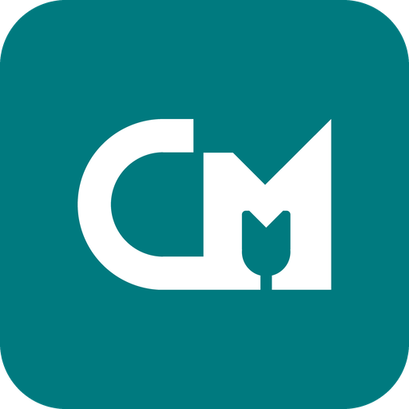</p>

# CordMic

**English** | [Bahasa Indonesia](README.id.md)

CordMic turns an Android phone into a low-latency PC microphone over a **USB cable**. It uses Android's built-in
**USB tethering**, so it needs no Wi-Fi, no USB debugging/ADB and no phone-side drivers. The phone captures and
cleans up the voice, streams it to a Windows tray app, and the tray app plays it into a virtual audio cable that
Discord, Zoom, OBS and games can select as a microphone.

Current version: **0.6.0** ([changelog](CHANGELOG.md), [downloads](https://github.com/Lukecinate/cordmic/releases/latest)).

- **Cable only.** The phone appears as a wired network adapter (RNDIS/NCM). Audio never uses Wi-Fi or the internet.
- **Low latency.** 48 kHz mono PCM in 5 ms packets, AAudio exclusive capture where the phone grants it, a
  jitter buffer sized to the real Windows render period, a resampling drift controller, pitch-based packet-loss
  concealment, and CordMic's own WASAPI renderer (IAudioClient3 shared or exclusive mode). Designed for roughly **30–45 ms end-to-end** (see [Latency](#latency)).
- **Voice processing on the phone.** Voice clarity EQ, noise cancellation (Off / Light / Strong), Auto volume
  toward −18 dBFS with a gate that follows the measured noise floor, a pause expander, and a −1 dBFS peak limiter.
- **Optional PC Studio noise reduction** (0.6.0, off by default). RNNoise on the PC with whisper protection and
  loudness-based Auto volume; the phone then sends unprocessed voice. Adds about 30 ms.
- **Per-phone auto-detection.** The phone probes its own capabilities (capture engines, microphones, platform
  effects, direction API, levels) and picks a capture path and starting settings. Nothing leaves the phone except
  a short summary sent to the PC over the cable. No telemetry.
- **Front focus by default.** Prefers the microphone facing the user where Android allows it.
- **Two-way live settings.** Voice settings can be changed on the phone or on the PC while streaming; the latest
  edit wins on both sides.
- **In-app updates** on both sides, verified against the release's `SHA256SUMS`, never downgrading.
- **Runs in the background.** Android foreground service with a persistent notification; Windows tray app that
  detects the phone, reconnects automatically and can start with Windows.
- **English and Indonesian** in the Android app, the Windows app and the installer.

---

## Contents
- [Screenshots](#screenshots)
- [Requirements](#requirements)
- [Install & quick start](#install--quick-start)
- [Using the Windows app](#using-the-windows-app)
- [Using the Android app](#using-the-android-app)
- [Voice processing](#voice-processing)
- [Updates](#updates)
- [Troubleshooting](#troubleshooting)
- [Known limitations](#known-limitations)
- [Privacy and security](#privacy-and-security)
- [Architecture & protocol](#architecture--protocol)
- [Latency](#latency)
- [Build from source](#build-from-source)
- [Python receiver (developer tool)](#python-receiver-developer-tool)
- [Version history](#version-history)
- [Upgrading from UsbMic](#upgrading-from-usbmic)
- [Roadmap](#roadmap)
- [License](#license)

## Screenshots

**Android app.** Real renders of the app's layouts, produced by the Robolectric screenshot test
(`./gradlew testDebugUnitTest -PrecordScreenshots`) with sample values; not photos of a physical phone.

| Waiting for USB tethering | Looking for your PC | Streaming to your PC |
|---|---|---|
| 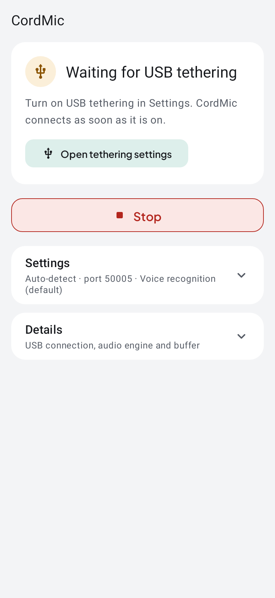 | 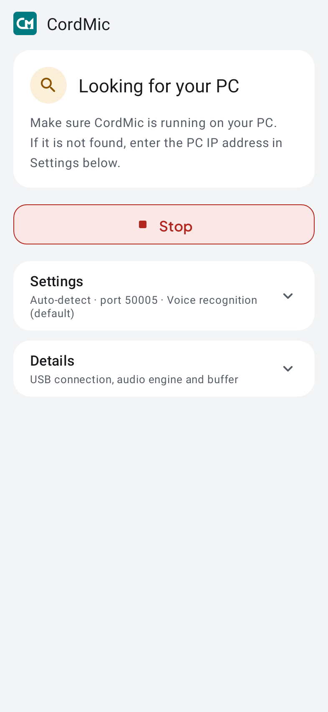 | 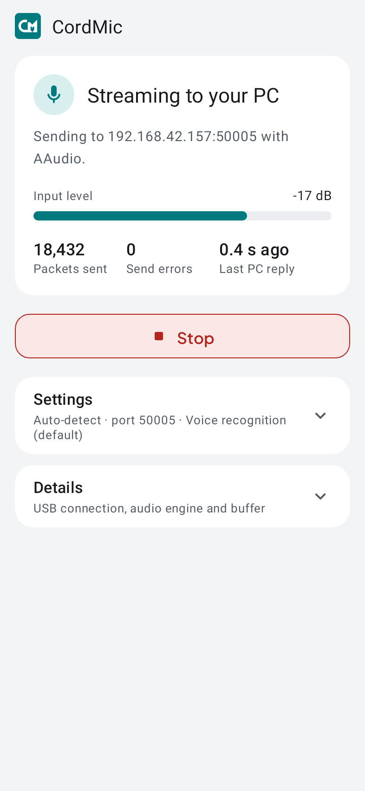 |

| Details expanded | Settings (idle) | Microphone unavailable |
|---|---|---|
| 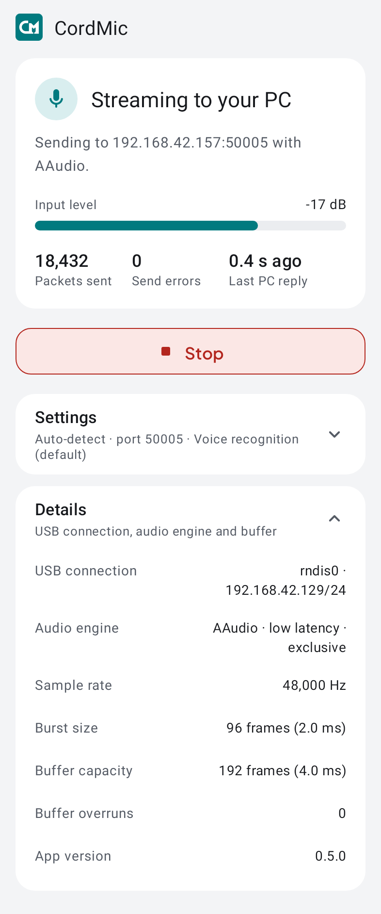 | 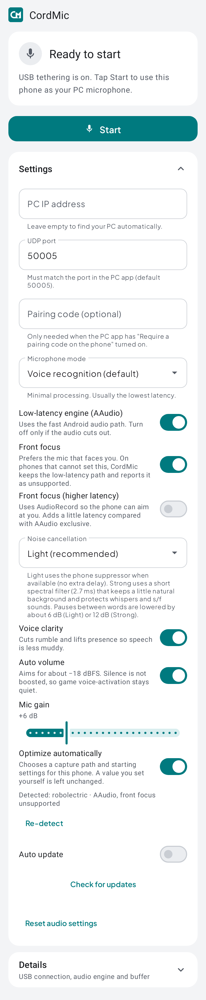 | 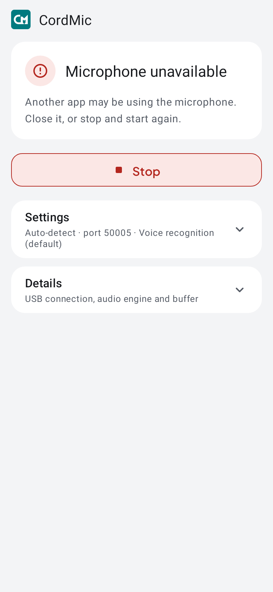 |

| Dark theme | Bahasa Indonesia | Small screen (320 dp) |
|---|---|---|
| 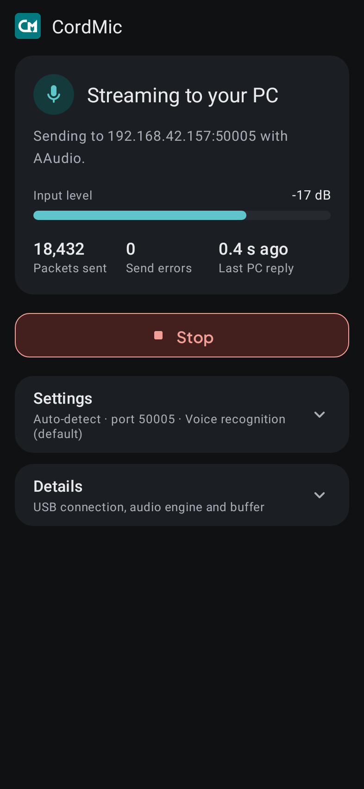 | 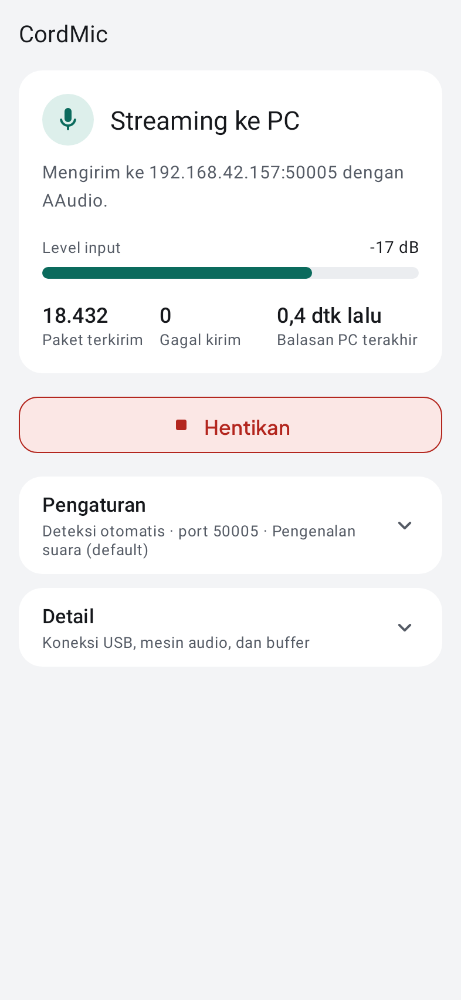 | 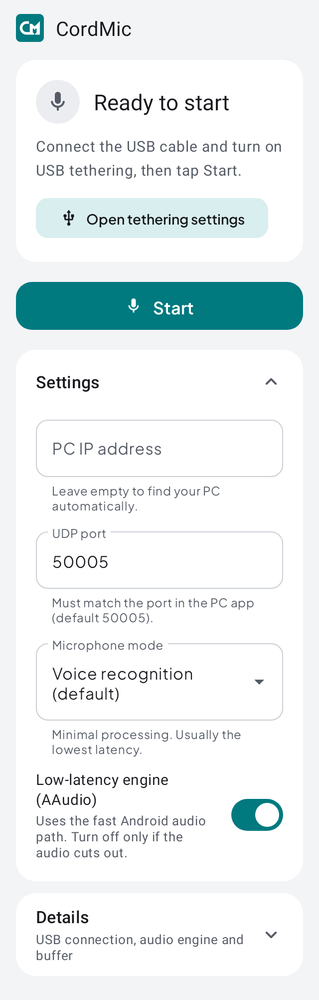 |

Landscape: [android-landscape.png](docs/screenshots/android-landscape.png).

**Windows app.** The connect window below is a layout render of the 0.5.1 header and connect button
(this environment cannot host WinForms), using the app's logo, icons, Plus Jakarta Sans
and colours, with sample values. It is not a capture of the running app. The older images are design
previews of the 0.4 setup guide.

| Connect window |
|---|
| 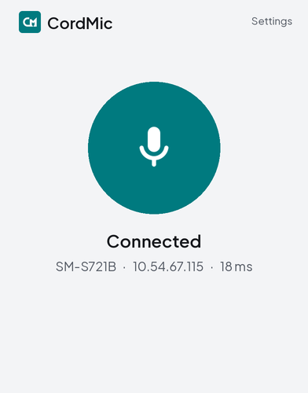 |

| Setup guide, streaming (0.4 preview) | Setup guide, waiting (0.4 preview) | Tray menu and tooltip |
|---|---|---|
| 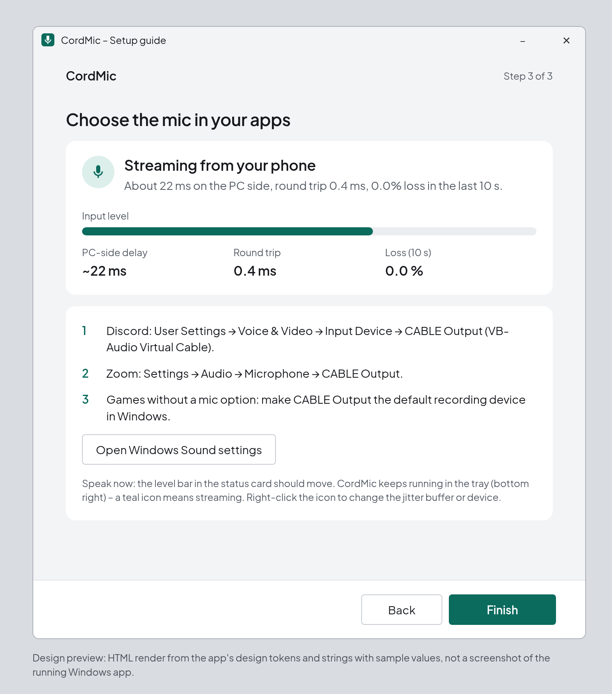 | 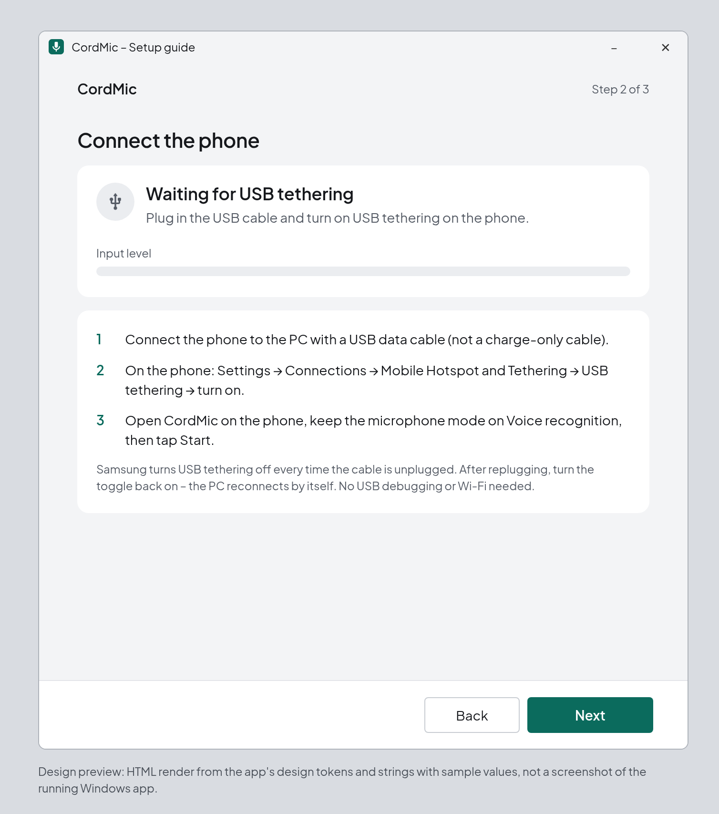 | 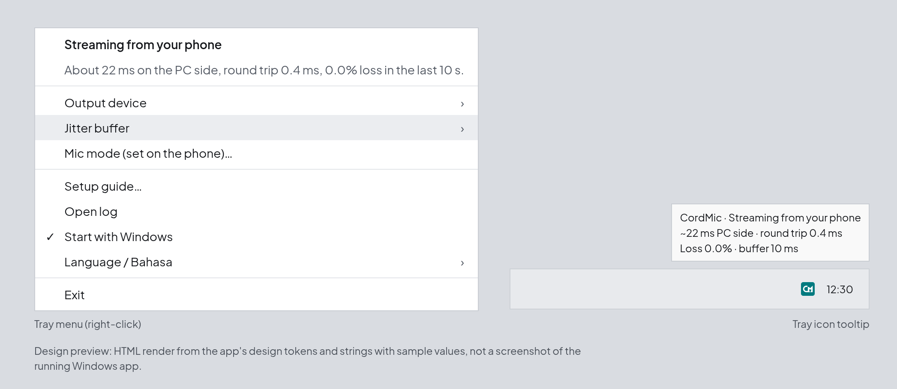 |

More: [virtual mic step](docs/screenshots/windows-wizard-cable-preview.png),
[Indonesian](docs/screenshots/windows-wizard-streaming-id-preview.png).

## Requirements

| | |
|---|---|
| PC | Windows 10 or 11, 64-bit (x64) |
| Phone | Android 10 or newer (minSdk 29) with USB tethering. Any manufacturer; settings are tuned per device automatically |
| Cable | A USB **data** cable (charge-only cables do not work) |
| Virtual mic | [VB-CABLE](https://vb-audio.com/Cable/) by VB-Audio (donationware). The installer and Settings can download the official package; it is never bundled |

## Install & quick start

From the [latest release](https://github.com/Lukecinate/cordmic/releases/latest) download
`CordMic-Setup-<version>.exe` (Windows) and `CordMic-<version>-release.apk` (Android). A portable build
(`CordMic-Portable-<version>.zip`) is also published; it does not install the firewall rule, the adapter task or
VB-CABLE, so the installer is recommended.

1. **Install on the PC.** Run `CordMic-Setup-<version>.exe` and accept the UAC prompt. The installer is not
   code-signed yet, so SmartScreen may show "Windows protected your PC": click **More info → Run anyway**.
   When no CABLE device is found, the optional **Install VB-CABLE** task is pre-selected. It downloads VB-Audio's
   official package over HTTPS, checks a pinned SHA-256 (and the Authenticode signer where possible) and starts
   VB-Audio's own setup, which shows its own window. A reboot may be required. The same action is available later
   under Settings → **Install VB-CABLE**.
2. **Install on the phone and connect.** Copy the APK to the phone and open it (allow "Install unknown apps" for
   the file manager; on Samsung, temporarily turn off Auto Blocker if it is on). Plug in the USB cable, turn on
   **USB tethering** (Samsung: *Settings → Connections → Mobile Hotspot and Tethering → USB tethering*), open
   CordMic and tap **Start**. The phone shows **Streaming to your PC** and the tray icon turns teal.
3. **Pick the mic in your app.** Choose **CABLE Output (VB-Audio Virtual Cable)** as the input device, e.g. Discord:
   *User Settings → Voice & Video → Input Device*; Zoom: *Settings → Audio → Microphone*. For games without a mic
   selector, make CABLE Output the default recording device in Windows Sound settings.

CordMic already aims for about −18 dBFS speech with peaks at or below −1 dBFS, so leave the other app's mic
volume around **50–60 %** rather than near maximum. With voice activation (open mic) in a game such as Valorant
or in Discord, use a moderate sensitivity threshold; a hair-trigger value can still open on breathing or keyboard
noise. With *Voice communication* on the phone, turn off Discord's own noise suppression and echo cancellation
to avoid processing the voice twice.

What the installer does:
- installs to `C:\Program Files\CordMic` with a Start menu shortcut (optional: start with Windows, desktop shortcut);
- adds the inbound firewall rule **CordMic (UDP 50005)** for the *Private* profile. The scheduled task below marks
  the phone's tethering network as *Private* and limits the rule to that network's subnet (from 0.6.1; before, the
  rule allowed the whole local subnet on every profile). With no phone connected the rule allows only `127.0.0.1`;
- adds the scheduled task `\CordMic\SetTetherMetric` (runs as SYSTEM at boot, logon and on network changes) that
  sets the phone adapter's interface **metric to 9999**, so internet traffic stays on LAN/Wi-Fi and the phone link
  carries only audio;
- runs `CordMic.exe --configure-cable`, which sets stereo *CABLE Input* and *CABLE Output* to 16-bit 48 kHz and turns
  off enhancements (backed up first; see [docs/SECURITY.md](docs/SECURITY.md));
- optionally downloads and starts the official VB-CABLE setup (see above).

Uninstall via *Settings → Apps → CordMic → Uninstall*. This restores the VB-CABLE format backup and removes the app,
shortcuts, autostart, firewall rule and scheduled task. Settings and logs under `%APPDATA%` / `%LOCALAPPDATA%` are kept.
VB-CABLE itself is not removed.

## Using the Windows app

### Tray icon

| Color | Meaning |
|---|---|
| Grey | Waiting for USB tethering, or *Phone found* but Start not tapped yet |
| Teal | Streaming from the phone, audio is flowing |
| Amber | Needs attention: no virtual mic installed, phone connected but not sending audio, or PC internet routed through the phone |
| Red | Error: UDP port 50005 is in use by another app, or the audio device failed to open (retried automatically) |

Hover the icon for the PC-side delay split (network = ½ USB round trip, the time-averaged jitter-buffer wait and
the measured Windows output buffer), plus round-trip time and packet loss over the last 10 seconds.

### Main window

Double-click the tray icon (or **Open CordMic**). The window has one round button (disconnected, searching,
connected, error), a status line with the phone model and the live PC-side delay, the **Detected:** line reported
by the phone (for example `Detected: SM-S721B · AAudio exclusive, 3 mics, front focus`), and a Settings panel:

| Setting | Default | Notes |
|---|---|---|
| Output device | Automatic | Best virtual cable found (VB-CABLE A–D, VAC, VoiceMeeter), or a specific device |
| Output mode | Auto | *Auto* picks the shortest stable period and tries Exclusive only when that is shorter. *Low latency* (shared, about one period queued), *Stable* (keeps the whole Windows buffer full; for busy PCs) or *Exclusive* (WASAPI exclusive; CordMic then owns "CABLE Input" and falls back to Low latency if refused). An explicit choice is never overwritten |
| Latency (jitter buffer) | Normal 10 ms | Low 5 / Normal 10 / Safe 20 ms, raised automatically to what the render period needs (see [Architecture](#architecture--protocol)) |
| Noise cancellation | Light | Off / Light / Strong (applied on the phone) |
| PC Studio noise reduction | Off | Off / Balanced / Whisper priority / Max, run on the PC (see [PC Studio noise reduction](#pc-studio-noise-reduction-optional)) |
| Voice clarity | On | High-pass, low-shelf and presence EQ (on the phone) |
| Auto volume | On | Gated AGC toward −18 dBFS (on the phone) |
| Front focus | On | Asks the phone for the mic facing the user where the capture path supports it |
| Front focus (higher latency) | Off | Switches the phone to AudioRecord so the direction can take effect on phones whose AAudio path cannot |
| Mic gain | +6 dB | 0 to +24 dB, applied on the phone before Auto volume |
| Start with Windows | Off | Also in the tray menu |
| Install / Optimize VB-CABLE | – | Shown when no cable is found, or when the cable format is not optimal |
| Check for updates, Auto update | Auto update off | See [Updates](#updates) |
| Reset audio settings | – | Restores the voice defaults above on both sides |
| Open logs | – | Opens the log folder |

Voice settings changed here are applied to the phone live, and changes made on the phone show up here. A control
that is focused, being dragged or open is not overwritten by an incoming value. A warning appears when speech stays
below about −40 dBFS after gain. Since 0.6.0 two more notices can appear under the noise settings: *Move the phone
closer (about 15 cm) for a cleaner sound* when the estimated speech-to-noise ratio stays below 15 dB for 10 s (hidden
again above 18 dB for 10 s), and a warning when Android reports that another app has silenced CordMic's microphone.

Right-click the tray icon for **Output device**, **Output mode**, **Jitter buffer**, **Mic mode (set on the
phone)**, **Open CordMic**, **Fix phone network priority** (shown only when internet goes through the phone; asks
for UAC), **Open log**, **Start with Windows**, **Language / Bahasa** (Automatic, English, Bahasa Indonesia) and **Exit**.

### Settings and logs

| What | Where |
|---|---|
| Settings | `%APPDATA%\CordMic\settings.json` |
| App log (stats every 10 s while connected) | `%LOCALAPPDATA%\CordMic\logs\cordmic.log` |
| VB-CABLE helper log | `%LOCALAPPDATA%\CordMic\logs\cable-helper.log` |
| VB-CABLE format backup | `%ProgramData%\CordMic\cable-format-backup.json` |
| Installer / metric task logs | `C:\ProgramData\CordMic\` |

A stats line looks like this (fields explained under [Python receiver](#python-receiver-developer-tool)):

```
stats peer=… rx=… lost=0 (0.00%) late=0 plc=0 underrun=… ovf=… buf=…ms jitter=…ms rtt=…ms bufavg=…ms bufmin=…ms
      slip=… period=2.7ms jtarget=15.0ms/3pkt urate=…/min orate=…/min nc=light agc=on gain=+6dB phone=AAudio-excl dir=…
      mics=… floor=-62dBFS gate=closed agcgain=+8.5dB exp=-6.0dB drift=…ppm uplc=… studio=off studiocpu=-
      studiogain=-dB snr=…dB silenced=0 devns=0 dev=…
```

From 0.5.7 the phone also reports its voice chain: `floor` = background noise level measured before the mic gain
(`~` until the first pause has been measured), `gate` = Auto volume gate (`open` while speaking), `agcgain` = current
Auto volume makeup (`off` when Auto volume is off), `exp` = current pause expander gain. They show `-` with an older
phone.

From 0.6.0: `drift` = clock difference corrected by the resampler, `uplc` = underrun frames filled by concealment,
`studio` = Studio state (`off`, a preset, `-fallback`, `-unavailable`, or `-nophoneack` when the phone has not confirmed
the bypass), `studiocpu` = Studio processing time per 10 ms frame, `studiogain` = Studio Auto volume gain, `snr` =
estimated speech-to-noise ratio behind the move-closer notice, `silenced` = Android silenced the phone's capture,
`devns` = the phone suspects hidden device noise suppression (logged only).

`jtarget` is the target in use, including any adaptive raise (0.5.6). `urate` / `orate` are underruns and
overflow drops per minute.

## Using the Android app

The screen is one status card plus one button. The card says what is happening (*Ready to start*, *Waiting for USB
tethering*, *Looking for your PC*, *Streaming to your PC*, *Microphone unavailable*) and offers one next step, such
as **Open tethering settings**. While streaming it shows the input level (after gain, matching what the PC
receives), packets sent, send errors and the age of the last PC reply.

1. Turn on USB tethering (see below).
2. Review **Settings**:

   | Setting | Default | Notes |
   |---|---|---|
   | PC IP address | empty (auto) | Leave empty to find the PC automatically |
   | UDP port | 50005 | Must match the PC app |
   | Microphone mode | Voice recognition | *Voice recognition* (minimal processing, usually lowest latency), *Unprocessed* (raw), *Voice communication* (platform NS/AEC/AGC, adds latency) |
   | Low-latency engine (AAudio) | On | Tries exclusive low-latency, then shared low-latency, then shared; falls back to AudioRecord |
   | Optimize automatically | On | Chooses the capture path and starting settings for this phone; a value set by the user is never overwritten. **Re-detect** runs the probe again |
   | Noise cancellation | Light | Light uses the phone's own suppressor when available (no added delay), otherwise CordMic's Light filter. Strong uses CordMic's spectral filter (2.7 ms). Both lower pauses between words (about 6 / 12 dB) |
   | Voice clarity | On | Cuts rumble, lifts presence |
   | Auto volume | On | Toward −18 dBFS; pauses are not boosted |
   | Front focus | On | Prefers the mic facing the user |
   | Front focus (higher latency) | Off | Uses AudioRecord so the direction can be applied |
   | Mic gain | +6 dB | 0 to +24 dB |
   | Auto update / Check for updates | Auto update off | See [Updates](#updates) |
   | Reset audio settings | – | Restores the voice defaults |

   PC IP, port, microphone mode and the AAudio switch are locked while streaming. Voice settings stay live and
   are synchronized with the PC.
3. Tap **Start** and grant the Microphone and Notification permissions. A persistent "CordMic" notification (with
   a Stop button) keeps capture running with the screen off or while other apps are in use.
   **Details** shows the capture engine, sharing and performance mode, sample rate, burst and buffer sizes,
   overruns, the USB interface and the app version. The **Detected:** line summarizes the device probe.
4. On phones with aggressive battery management, allow unrestricted background use (Samsung:
   *Settings → Apps → CordMic → Battery → Unrestricted*, and keep CordMic out of "Sleeping apps").

The app follows the system light/dark theme and language (English or Bahasa Indonesia). Android 14+ only allows a
microphone foreground service to start while the app is visible, so **Start** must be tapped from the app screen
and the service does not start after a reboot.

### Device auto-detection

At start-up, when a headset/USB/Bluetooth mic is plugged in or removed, and again when a session starts, the phone
probes its API level and model, built-in microphones, AAudio low-latency and exclusive support, platform noise
suppression / AGC / AEC, the microphone-direction API, input presets, native rate and burst, stereo capture and
the first seconds of input level. There is no polling loop. Based on the result it picks AAudio exclusive when
granted, otherwise shared AAudio, otherwise AudioRecord; uses the Voice recognition preset; turns Front focus on;
uses Light noise cancellation; and sets a starting gain from the measured level. The probe stays on the device;
only a short capability summary plus the model name is sent to the PC over the existing link.

### USB tethering
1. Connect the phone with a USB data cable.
2. Turn on USB tethering. Samsung: **Settings → Connections → Mobile Hotspot and Tethering → USB tethering**. Other
   phones usually have it under *Network & internet → Hotspot & tethering*. The toggle stays grey until a cable is
   connected. USB debugging is **not** needed.
3. Windows shows a new adapter, usually "Remote NDIS based Internet Sharing Device" or "UsbNcm".

## Voice processing

All voice processing runs on the phone, before the packet is sent. The chain is the same in Kotlin
(`VoiceChain.kt`) and in the C# reference implementation (`CordMic.Core/VoiceChain.cs`), which carries the tests.

1. **Voice clarity** (optional): 120 Hz high-pass, −5 dB low shelf at 220 Hz, +2.5 dB presence at 3 kHz.
2. **Noise suppression**: Light uses the platform `NoiseSuppressor` when available; otherwise (and for Strong) a
   Hann-windowed 256-point STFT with 50 % overlap (2.67 ms added delay). Each bin uses a Wiener gain from a
   decision-directed SNR estimate, smoothed across neighbouring bins and over time (faster to open than to close), with
   a floor of −10 dB (Light) or −15 dB (Strong) so a little natural background remains and leftover hiss does not
   flutter. The noise estimate follows quieter passages quickly and rises only about 3 dB/s otherwise, so speech,
   whispers and fricatives do not train it. While the band above 3 kHz is clearly above its noise, those bins are
   kept at −4.4 dB or higher so s/f/sh sounds and whispers survive Strong.
3. **Mic gain**, ramped over about 20 ms when changed.
4. **Gate and noise floor**, measured before the gain. The floor is tracked continuously (down within about 0.3 s,
   up at most 1.5 dB/s in pauses). The gate opens about 10 dB and closes about 4 dB above the floor, with a 200 ms hold.
5. **Auto volume**: an RMS envelope (~40 ms) is driven toward −18 dBFS; makeup is limited so the floor stays at or
   below −52 dBFS after gain, and released toward unity in pauses.
6. **Pause expander**: about −6 dB (Light) or −12 dB (Strong) while the gate is closed.
7. **Peak limiter** at −1 dBFS.

### PC Studio noise reduction (optional)

Off by default. When a Studio preset is selected on the PC, the PC asks the phone (PING flag, 0.6.0 phones) to skip
its noise suppression, gate, Auto volume and pause expander, so noise reduction is not applied twice. Mic gain, Voice
clarity and the limiter stay on the phone. The phone's stored settings do not change and apply again as soon as Studio
is off. On the PC, a worker thread (not the audio callback) runs:

1. **RNNoise** (BSD-3, native `rnnoise.dll`) at 48 kHz, in parallel with a PC copy of the 0.5.7 Strong suppressor,
   time-aligned to RNNoise's 20 ms delay.
2. **WhisperGuard** mixes back toward the Strong output while RNNoise is removing a clearly present signal (a whisper
   or a soft consonant). *Balanced* (default preset), *Whisper priority* (mixes back more, keeps whispers best) and
   *Max* (RNNoise only, strongest cleaning, may thin whispers). Since 0.6.2 the guard opens only after the signal
   has been present for 300 ms (or RNNoise detects voice) and releases over about 200 ms, so short bumps do not
   switch it on and off.
3. **Auto volume (B3)**, when Auto volume is on: loudness (LUFS) based, toward −21 LUFS, frozen in pauses, with a
   −1 dBFS limiter. The gain is capped so the boosted background stays at or below −60 dBFS. Its gain is remembered
   between sessions, at most +15 dB.
4. **Comfort floor** (0.6.2): a very low noise bed 55 dB below the output speech loudness (at most −65 dBFS, and below the room's own noise), so pauses never drop to digital silence
   and the step between speech and pauses stays small.

Added latency is about 40 ms (RNNoise 20 ms plus two 10 ms worker frames; one frame before 0.6.2). Processing takes about 0.55 ms per 10 ms
frame on the build machine with no per-frame allocation. A render pull that finds the worker's buffer short is filled
by repeating the last pitch period (counted as `studiounder=` / `studiomiss=` in the log) instead of a short silence.
Changing the Studio preset switches on the fly without rebuilding the jitter buffer. While no phone is connected the
Studio worker is paused. If the worker misses 3 deadlines within 1 s, Studio turns off
for the session, a notice appears and the phone's own noise cancellation is used again. With a phone older than
0.6.0 the PC shows that the phone has not confirmed the bypass.

## Updates

Both apps can **Check for updates**, and an optional **Auto update** toggle (off by default) checks at launch and
about every six hours. CordMic reads the latest GitHub Release of `Lukecinate/cordmic` over HTTPS without an
account, verifies the downloaded asset against the release's `SHA256SUMS`, and never installs an older version.
Android also requires the APK signing certificate to match the installed app and hands the file to the system
installer (Install is tapped once; "install unknown apps" may be requested). Windows runs the verified setup with
`/S`; UAC or SmartScreen may still appear. No other data is sent.

## Troubleshooting

| Symptom | Try |
|---|---|
| Icon stays grey, "Waiting for USB tethering" | Use a **data** cable. Turn USB tethering on again (many phones turn it off on every unplug). Windows *Settings → Network* should list a "Remote NDIS…" / "UsbNcm…" adapter |
| "Phone found" but not streaming | Open CordMic on the phone and tap *Start*. Check that the firewall rule *CordMic (UDP 50005)* exists (re-run the installer if it is missing) |
| Red, "Port busy" | Another receiver (e.g. the Python `cordmic_receiver`) is running. Close it; CordMic retries every 5 seconds |
| Amber, "No virtual mic yet" | Use **Install VB-CABLE** in Settings; restart the PC if the device does not appear |
| Crackle or short dropouts | Check `underrun` / `ovf` / `urate` in the log. Since 0.5.6 the target rises by itself after repeated underruns; if they continue, choose *Latency → Safe (20 ms)* and then *Output mode → Stable*. Avoid USB hubs |
| Studio switched itself off | The PC could not keep up (3 missed deadlines in 1 s). Close heavy background apps, or use the phone's noise cancellation |
| Voice sounds distant or muddy | Follow the *Move the phone closer* notice: about 15 cm. Noise reduction cannot remove room echo |
| "Microphone silenced" warning | Another app (often a voice assistant or recorder) took the microphone. Close it |
| Hiss between words | Keep Noise cancellation on Light or Strong (both lower pauses), lower Mic gain and let Auto volume do the rest. Keep the game's voice-activation threshold moderate. The log's `floor` shows the phone's background level (above about −50 dBFS is a noisy room or a high Mic gain) |
| Voice too quiet | Move closer, raise Mic gain a few dB, and leave Auto volume on. A warning appears below about −40 dBFS |
| Front focus shows "unsupported" | The phone's AAudio path has no direction API. Turn on *Front focus (higher latency)* to use AudioRecord, or leave it off for the lowest latency |
| Game ping rises after plugging in the phone | *Fix phone network priority* in the tray menu (or run `C:\Program Files\CordMic\tools\set-tether-metric.ps1` as administrator), or turn off mobile data on the phone |
| Discord hears nothing | The input device must be **CABLE Output** (not CABLE Input) |
| Audio sounds over-processed or delayed | Use *Voice recognition* on the phone. With *Voice communication*, turn off Discord's noise suppression and echo cancellation |
| Update check fails | The PC or phone needs internet access through its normal connection (not the tether link). Downloads can also be taken from the Releases page |

Manual metric fix (PowerShell as administrator):
```powershell
Get-NetAdapter                                                  # find the phone adapter, e.g. "Ethernet 3"
Set-NetIPInterface -InterfaceAlias "Ethernet 3" -InterfaceMetric 9999
Get-NetRoute 0.0.0.0/0                                          # the default route should use LAN/Wi-Fi
```

When reporting an issue, attach `cordmic.log` and mention the phone model, the **Detected:** line and the
settings in use. Do not attach voice recordings to public issues.

## Known limitations

- **Unsigned Windows installer.** The installer and `CordMic.exe` are not Authenticode-signed, so SmartScreen
  warns on first run. Verify downloads with `SHA256SUMS` from the release.
- **USB tethering must be turned on manually.** Android does not let regular apps enable tethering, and many
  phones turn it off when the cable is unplugged. The PC side reconnects automatically after it is re-enabled.
- **A virtual cable is required.** Windows lists only microphones that come from an audio driver, and a user-mode
  app cannot create one. CordMic plays into an existing virtual cable (see [Roadmap](#roadmap)).
- **Front focus on the AAudio path.** AAudio has no microphone-direction API, so on the low-latency path the
  setting is reported as unsupported unless *Front focus (higher latency)* is used.
- **APK signing.** Since 0.3.1 the release APK is signed with the project's release key (certificate
  `CN=CordMic, O=CordMic contributors`, SHA-256
  `2c:da:64:ae:df:4e:ba:6f:9d:4a:fa:06:e6:85:43:04:65:a6:0d:5d:2a:25:ef:99:ee:f3:cc:16:3e:47:1c:8b`). The APK is
  distributed outside Google Play. Version 0.3.0 used a debug key; uninstall it before installing a later version.
- **Round-trip time is PC-side only.** The phone answers the PC's PING but does not time it, so the phone app
  shows the age of the last PC reply instead.
- **Studio latency and loudness.** PC Studio noise reduction adds about 40 ms, more than the 12 ms target in the
  0.6.0 plan, which is why it is opt-in. Whispers can stay a few LU below the −21 LUFS target, and bumps such as a
  bus or keyboard can still be heard in pauses with Balanced (Max avoids that).
- **Device checks not done on hardware.** The silenced-microphone warning and privacy-sensitive capture follow the
  Android documentation but were not tested on a phone for this release.
- **Android 14+ start rule.** Capture must be started from the visible app; it does not start on boot.

## Privacy and security

- Audio travels only over the USB tethering link to the PC on the local subnet; it is not stored by CordMic.
- The device probe runs on the phone. Only a short capability summary and the model name are sent to the PC.
- There is no telemetry or analytics. The only internet requests are the optional update check (GitHub Releases)
  and the optional VB-CABLE download from vb-audio.com, both over HTTPS.
- The tray app runs as the signed-in user. Changing the VB-CABLE format uses a fixed-verb elevated helper mode;
  see [docs/SECURITY.md](docs/SECURITY.md) for what it changes and how to undo it.

## Architecture & protocol

```
┌──────────────── Android phone ───────────────┐   USB cable     ┌──────────────── Windows PC ──────────────────┐
│ Mic → AAudio exclusive / shared or           │ (USB tethering, │ CordMic tray app (.NET 8)                    │
│       AudioRecord (48 kHz mono s16, 5 ms)    │  RNDIS/NCM =    │  UDP :50005 → jitter buffer                  │
│   → clarity EQ, noise suppression, gain,     │  network link)  │    (period-aware, adaptive, drift lock)      │
│     gate, Auto volume, expander, limiter     │ ──────────────▶ │  → own WASAPI renderer (IAudioClient3,       │
│   → 20-byte header (seq + timestamp)         │                 │    shared or exclusive) → "CABLE Input"      │
│ Foreground service type=microphone           │ ◀── HELLO/PING  │  Discord/Zoom/games use "CABLE Output"       │
│ + device probe + persistent notification     │                 │  as their microphone                         │
└──────────────────────────────────────────────┘                 └──────────────────────────────────────────────┘
```

- **Transport.** USB tethering makes the phone appear as a wired network adapter in Windows (built-in RNDIS/NCM
  drivers). No ADB, no Wi-Fi, no USB debugging.
- **Discovery.** With tethering on, the phone is the gateway/DHCP server. The app finds the tethering interface
  (`rndis0` / `ncm0` / `usb0`) and broadcasts **DISCOVER**; the PC replies **HELLO** (the Windows app also sends
  HELLO to the gateway when it sees a tethering adapter), and the phone then streams unicast to the PC. The PC IP can
  also be entered manually.
- **Keep-alive, control and reconnect.** The PC sends **PING** every 500 ms from a separate socket and thread; the
  phone answers **PONG**. PING carries the PC's voice settings, PONG reports the phone's state. If the phone hears
  nothing for 3 seconds, or the socket fails after an unplug, it returns to discovery. A disconnected capture
  stream (e.g. a route change) is reopened.
- **Header** (20 bytes, little-endian; identical in `Protocol.kt`, `protocol.py` and `CordMic.Core`):

  | Offset | Size | Field |
  |---|---|---|
  | 0 | 2 | magic `"UM"` |
  | 2 | 1 | version (1) |
  | 3 | 1 | type: 1 AUDIO, 2 DISCOVER, 3 HELLO, 4 PING, 5 PONG, 6 BYE |
  | 4 | 4 | sequence number (uint32, wraps) |
  | 8 | 8 | timestamp in µs (sender's monotonic clock) |
  | 16 | 2 | PCM frame count |
  | 18 | 2 | flags: bits 0–3 codec (0 = PCM s16le), bits 4–7 channels − 1, bits 8–11 sample rate (0 = 48 kHz), bits 12–14 noise cancellation, AGC, AAudio |

  An AUDIO payload is raw PCM: 240 frames × 2 bytes = 480 bytes per 5 ms (~100 kbit/s).
  PING/PONG carry a control payload (magic `0xC5`): noise mode, voice clarity, AGC, front focus (both variants)
  and gain on PING; engine, exclusive / low-latency, direction code, mic count, model name and a speech-level flag on
  PONG. From 0.5.5 both sides can append per-setting sequence numbers and origins so that the latest edit wins.
  From 0.5.7 the PC sets a request bit in that block and the phone then adds a 6-byte diagnostics block (magic
  `0xC7`: pre-gain floor, gate, AGC gain, expander gain, check byte) between the name and the sync block. It is sent
  only when asked and only to the connected PC; nothing leaves the USB link. Older apps ignore the extra bytes; the
  wire version is still 1. 0.6.0 adds a Studio bit (bit 5) to the PING flags and three diagnostics flags (capture
  silenced, Studio bypass active, device noise suppression suspected); older peers ignore them.
- **Jitter buffer.** Reorders packets by sequence number. Since 0.6.0 lost packets and underruns are concealed by
  repeating the last pitch period with a 2 ms crossfade, full level for 10 ms and then a fade (silent after 30 ms of
  continuous loss),
  and clock drift is corrected by a cubic resampler driven by a PI controller on the buffer fill instead of sample
  slips (the `slip` field stays 0). Before 0.6.0 single gaps were concealed with a short decay. The preset
  (Low 5 / Normal 10 / Safe 20 ms) is raised to at least two render pulls, or three packets (15 ms) when one pull
  consumes a single packet (a 2.7 ms period). Overflow trims to one period above the target; the hard cap is the
  target plus three render periods (five for a single-packet pull). A sample-level drift lock (slow PI controller,
  crossfaded slips, ±150 ppm rising toward ±800 ppm for a sustained clock error) keeps the depth on target. Since
  0.5.6 the target rises by one packet after two underruns within 10 s (up to three packets) and steps back after
  60 s without one; underruns fade out over 2 ms and resume with a ramp, and overflow trims splice from the last sample.
- **Output.** CordMic's own event-driven WASAPI loop on an MMCSS "Pro Audio" thread. *Low latency* opens the stream
  with IAudioClient3 at the engine's minimum shared period and writes at most one period per callback; *Exclusive*
  uses WASAPI exclusive mode at the device minimum.

### Repository layout

```
cordmic/
├── android/                      Gradle project (Kotlin + C++/AAudio)
│   └── app/src/main/
│       ├── cpp/aaudio_capture.cpp  AAudio capture (JNI)
│       ├── java/dev/cordmic/     MainActivity, MicService, Streamer, Capture, VoiceChain, DeviceProbe,
│       │                         DeviceTune, SettingsSync, AppUpdate, UpdateInstaller, TetherNet, Protocol
│       └── res/values[-in]/      English and Indonesian strings (+ values-night for the dark theme)
├── docs/                         screenshots, logo (assets/), SECURITY.md, THIRD_PARTY_NOTICES.md
├── third_party/fonts/            Plus Jakarta Sans + OFL license
├── third_party/rnnoise/          rnnoise.dll (win-x64) + BSD-3 COPYING + SHA256SUMS
├── tools/brand/                  logo generator
├── tools/harness/                regression harness (developer tool, not shipped; data downloaded at test time)
├── tools/rnnoise/                pinned RNNoise build script (zig cc)
├── windows-app/                  Windows app, C# / .NET 8
│   ├── src/CordMic.Core/         protocol, jitter buffer and policy, receiver, voice chain (reference),
│   │                             settings and sync, device tuning, update logic, string tables
│   ├── src/CordMic.App/          WinForms tray app, WASAPI renderer, VB-CABLE helper and installer, updater
│   ├── src/CordMic.Harness/      console receiver for loopback testing
│   ├── tests/CordMic.Tests/      xUnit tests (incl. interop with sim_sender.py)
│   ├── installer/                cordmic.nsi + tools/*.ps1 (firewall, adapter metric, VB-CABLE download)
│   └── build.sh                  test → publish win-x64 → installer
└── windows-receiver/             Python reference receiver + phone simulator (sim_sender.py)
```

## Latency

The pipeline is **designed for roughly 30–45 ms end-to-end**. This is a design budget, not a measurement:
capture ~3–10 ms + 5 ms packet + USB link 1–2 ms + 10–15 ms jitter buffer + WASAPI/VB-CABLE ~3–20 ms, plus 2.7 ms
when Strong noise cancellation is on, or about 40 ms when PC Studio noise reduction is on. Actual latency depends on the phone, the capture path and the PC audio stack.
*Front focus (higher latency)* and *Voice communication* add capture delay.

**PC-side delay shown by the app:** network (½ round trip) + jitter buffer (time-averaged) + Windows output (the
measured average fill of CordMic's WASAPI buffer). It leaves out phone capture, the Windows audio engine, VB-CABLE's
own buffering and the recording app.

For the lowest delay: *Latency → Low*, *Output mode → Auto* (or *Exclusive*), Noise cancellation on Light, Voice
clarity and Auto volume on, game/Discord mic volume at 50–60 %, and *Optimize VB-CABLE* so both "CABLE Input" and
"CABLE Output" are 48 kHz stereo.

To measure it: in OBS add two *Audio Input Capture* sources, (a) "CABLE Output" and (b) another physical mic.
Record, clap close to **both** mics, and measure the distance between the two clap peaks in Audacity. The difference
is CordMic's latency minus the reference mic's latency.

## Build from source

### Windows app and installer
Requires the .NET 8 SDK, NSIS 3 (`makensis`) and Python 3 (used by interop tests). Works on Windows (Git Bash/WSL),
Linux or macOS:
```bash
cd windows-app && ./build.sh
```
Runs the tests, publishes `windows-app/publish/CordMic.exe` (win-x64, self-contained, single file) and writes
`dist/CordMic-Setup-<version>.exe`. The portable zip is the contents of `windows-app/publish/`.

### Android app
Requires JDK 17, Android SDK Platform 34 and Build-Tools 34, NDK 26.1.10909125 and CMake 3.22.1
(Android Studio or `sdkmanager`). Built with AGP 8.5.2, Gradle 8.7 and Kotlin 1.9.24.
```bash
cd android
echo "sdk.dir=/path/to/Android/Sdk" > local.properties   # Android Studio creates this automatically
./gradlew testReleaseUnitTest assembleRelease
```
Release signing is read from a properties file outside the repository (`storeFile`, `storePassword`, `keyAlias`,
`keyPassword`), passed via `CORDMIC_SIGNING_PROPERTIES=/path/file` or `-PcordmicSigning=/path/file`. Without it,
local release builds are signed with the debug key, and the in-app updater will refuse them as updates to an
official install.

### Tests
| Suite | Command | Covers |
|---|---|---|
| Python (24 tests) | `cd windows-receiver && python -m unittest discover -s tests` | protocol, jitter buffer, output callback, UDP loopback (clean and lossy) |
| .NET (189 tests) | `cd windows-app && dotnet test tests/CordMic.Tests` | protocol golden vectors, jitter buffer, policy simulations and drift lock, adaptive target, underrun/overflow continuity, voice chain and quality (THD+N, clicks, hiss, Strong gain flutter, whisper/fricative retention), phone diagnostics, settings sync, device tuning, updates and checksums, VB-CABLE rules, ping backoff, UDP loopback, interop with `sim_sender.py`, localization tables, 0.6.0 PLC/resampler vectors and closed-loop drift, RNNoise delay, Studio CPU and allocations, watchdog, WhisperGuard, B3 Auto volume, move-closer hint |
| Kotlin (46 tests) | `cd android && ./gradlew testReleaseUnitTest` | header compatibility, voice chain (delay, gain ramp, limiter, pre-gain gate, expander, Strong gain flutter, whisper/fricative retention), diagnostics block, settings sync, update parsing, English/Indonesian string parity, level meter, Studio bypass, diagnostics flags, guarded mic-direction calls, hidden-NS check, Robolectric screenshot renders (`-PrecordScreenshots` rewrites `docs/screenshots/android-*.png`) |

The release gates for noise reduction and Auto volume (DNSMOS, ESTOI, PESQ, LUFS) run on the shipping C# code through
`tools/harness/` with data downloaded at test time; see [tools/harness/README.md](tools/harness/README.md).

## Python receiver (developer tool)

`windows-receiver/` contains the reference receiver used for protocol development and debugging. For everyday use,
install the Windows app instead (both bind UDP 50005, so run only one).

```bat
cd windows-receiver
pip install -r requirements.txt
python -m cordmic_receiver --list-devices
python -m cordmic_receiver --device "CABLE Input" --jitter-ms 10
```

| Option | Default | Meaning |
|---|---|---|
| `--device` | default output | device index or part of its name (e.g. `"CABLE Input"`) |
| `--jitter-ms` | 10 | jitter buffer target |
| `--exclusive` | off | WASAPI exclusive mode |
| `--blocksize` | 240 | callback block size (5 ms) |
| `--channels` | 2 | mono duplicated to stereo |
| `--tray` | off | tray icon (pystray + pillow) |
| `--log file` | – | write logs and stats to a file |
| `--no-audio` | off | receive and print stats only |

Stats fields (shared with the Windows app log): `lost` = sequence gaps, `plc` = concealed slots, `late` = packets
that arrived after their turn, `underrun` = buffer empty, `ovf` = packets dropped because the buffer was full,
`jitter` = arrival jitter (RFC 3550), `rtt` = PING/PONG round trip over USB, `slip` = drift-lock sample adjustments
(the Windows app uses the resampler since 0.6.0, so it reports 0).

Without a phone, `python sim_sender.py --host 127.0.0.1 --seconds 10` sends a 440 Hz test tone (`--loss` and
`--jitter-ms` simulate a bad link).

## Version history

| Version | Highlights |
|---|---|
| 0.6.0 | Pitch-based packet-loss concealment, resampling drift control, optional PC Studio noise reduction (RNNoise + WhisperGuard + LUFS Auto volume), silenced-mic warning, privacy-sensitive capture, move-closer hint |
| 0.5.7 | Smoother Strong noise reduction (spectral floor, per-band gain smoothing, whisper and consonant protection); phone noise floor, gate, Auto volume gain and expander in the PC log |
| 0.5.6 | Pre-gain gate and continuously tracked noise floor, floor-limited AGC makeup, pause expander, gain ramp; jitter-buffer underrun fades, overflow splices and an adaptive target |
| 0.5.5 | Front focus (higher latency) via AudioRecord, relative AGC gate, in-app updates, live two-way settings, optional official VB-CABLE download |
| 0.5.4 | Front focus on by default, background device detection, Optimize automatically, Detected line, RMS-based AGC |
| 0.5.3 | Drift lock without hunting, Hann-overlap noise suppression, Light/Strong modes, voice clarity EQ, silence not boosted |
| 0.5.2 | Stereo CABLE Input preferred, IAudioClient3 minimum period, Output mode Auto, Optimize VB-CABLE, sample-level drift lock |
| 0.5.1 | Connect window layout fixes |
| 0.5.0 | Render-period-aware jitter target, one-period writes, IAudioClient3, noise cancellation, mic gain and AGC, one-button desktop window |
| 0.4.2 | Own WASAPI renderer (no NAudio), separate ping socket, backlog trimming, measured PC-side delay |
| 0.4.1 | New logo |
| 0.4.0 | Android and Windows apps redesigned around one status card |

Full details: [CHANGELOG.md](CHANGELOG.md).

## Upgrading from UsbMic

CordMic was previously called **UsbMic**. The audio protocol is unchanged (`UM` header, UDP 50005).

- **Windows:** run the CordMic installer. It closes `UsbMic.exe` and removes the old firewall rule, scheduled task
  `\UsbMic\SetTetherMetric`, startup entry, shortcuts, `C:\Program Files\UsbMic` and the old uninstall entry.
  Settings in `%APPDATA%\UsbMic` are copied to `%APPDATA%\CordMic` on first start.
- **Android:** the package name changed (`dev.usbmic` → `dev.cordmic`), so CordMic installs as a new app. Grant the
  permissions again and uninstall the old UsbMic app so the two do not compete for the mic.

## Roadmap

1. **Opus** (48 kHz, 2.5/5 ms frames, FEC) as an option; PCM stays the default.
2. **Native virtual audio driver** ("CordMic Microphone" without VB-CABLE), based on Microsoft's SysVAD samples or
   ACX on Windows 11. Kernel drivers must be signed through Microsoft (EV certificate + attestation signing), which
   is why this is a separate milestone.
3. **Code signing** (Authenticode) for the installer and app so SmartScreen does not warn.
4. ~~Better packet-loss concealment~~ — shipped in 0.6.0 (pitch repetition).
5. ~~Clock-drift compensation~~ — shipped in 0.5.2, resampler-based since 0.6.0.
6. Whisper-aware loudness for Studio Auto volume, and a stricter WhisperGuard trigger for transient noise in pauses.

## License

[MIT](LICENSE) © CordMic contributors. VB-CABLE is a separate donationware product by [VB-Audio](https://vb-audio.com/Cable/) and is not included or modified.

Design assets: the CordMic logo is an original project asset (generated by `tools/brand/make_logo.py`); the in-app
icons are [Material Icons](https://fonts.google.com/icons) (Round style, Apache 2.0) by Google; the UI font is [Plus Jakarta Sans](https://github.com/tokotype/PlusJakartaSans)
(SIL Open Font License 1.1). Details and the other libraries are listed in
[docs/THIRD_PARTY_NOTICES.md](docs/THIRD_PARTY_NOTICES.md).

## Author

CordMic is developed by [Lukecinate (Rozan Abid)](https://github.com/Lukecinate).
